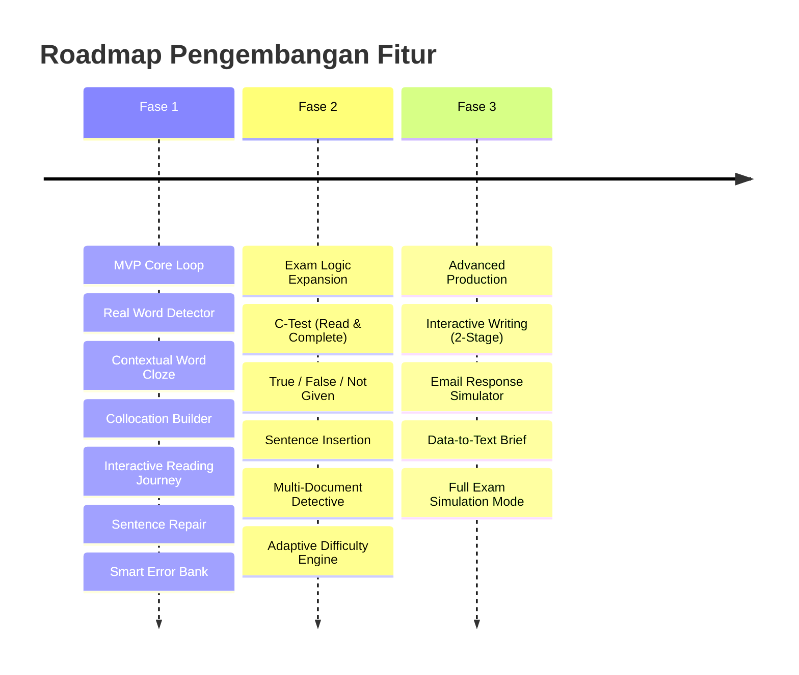

# Ringkasan Komprehensif Fitur: English Proficiency Lab (CEFR B1–B2)

> **Dokumen Konsolidasi Fitur & Rancangan Produk**  

---

## 1. Visi Produk & Prinsip Inti Desain

### Target Pengguna & Cakupan
- **Target Audiens**: Mahasiswa dan profesional dewasa yang mempersiapkan ujian **IELTS Academic** (target Band 6.0–7.5) dan **TOEIC** (target skor 650–850+).
- **Tingkat Kemahiran (CEFR)**: **B1 – B2** (Intermediate ke Upper-Intermediate). Sistem dikunci pada level ini (tidak turun ke materi dasar A1/A2 dan tidak melompat ke C1/C2 akademis murni).
- **Fokus Keterampilan**: **Vocabulary in Context**, **Reading Comprehension**, dan **Writing Production**.

### Batasan Produk (Non-Negotiables)
1. **Tanpa Flashcard Terisolasi**: Kosakata tidak dihafal lewat kartu arti-kata lepas, melainkan dipelajari dan diuji langsung dalam kalimat atau paragraf kontekstual.
2. **Tanpa Audio & Video**: Aplikasi berbasis teks interaktif murni (text-first desktop/web app) dengan efisiensi tinggi.
3. **Bebas Gamifikasi Kekanak-kanakan**: Menghilangkan maskot hewan/kartun, sistem "nyawa/energi" yang menghukum, koin virtual, dan animasi berlebihan.
4. **Adult-Friendly UX**: Antarmuka bersih bergaya *proficiency testing platform* / *research lab* profesional (menggunakan font serif untuk teks bacaan, visual minimalis, bar waktu tipis, akurasi persentase).

### DNA Pedagogis: Kombinasi 3 Referensi Utama
- **Duolingo English Test (DET)**: Sumber inspirasi utama untuk interaksi yang cepat, adaptif, *micro-challenges*, *multi-step passages*, serta *real-time pacing*.
- **IELTS Academic**: Rujukan untuk pemahaman bacaan mendalam (*evidence-based*, *inference*, *True/False/Not Given*, *matching headings*) serta struktur argumen akademis (*nominalization*, *paraphrasing*, *data description*).
- **TOEIC (Listening & Reading + Writing)**: Rujukan untuk tata bahasa dalam konteks kerja, ketepatan kolokasi bisnis, analisis multi-dokumen (*email + jadwal + memo*), serta simulasi respons email profesional.
- **Referensi Tambahan**: Mekanisme kalimat rumpang dari *Clozemaster*, *interactive reader* & penyimpan kosakata dari *Readlang/LingQ*, serta kurikulum berjenjang dari *Busuu/Babbel*.

---

## 2. Rincian Fitur & Tipe Kuis per Kategori Keterampilan

```mermaid
flowchart TD
    App["English Proficiency Lab (B1–B2)"]
    
    App --> Vocab["1. Vocabulary & Lexical Precision"]
    App --> Read["2. Reading & Discourse Logic"]
    App --> Write["3. Writing & Syntactic Agility"]
    App --> Core["4. Supporting Engine & Adult UX"]

    Vocab --> V1["Real Word Detector (DET)"]
    Vocab --> V2["C-Test / Read & Complete (DET)"]
    Vocab --> V3["Contextual Word Cloze"]
    Vocab --> V4["Collocation Sprint / Builder"]
    Vocab --> V5["Synonym & Precision Choice"]
    Vocab --> V6["Word Form Challenge (Morfologi)"]

    Read --> R1["Interactive Reading Journey (DET)"]
    Read --> R2["Evidence Hunt / Highlight Answer"]
    Read --> R3["True / False / Not Given (IELTS)"]
    Read --> R4["Sentence Insertion (Kohesi)"]
    Read --> R5["Multi-Document Detective (TOEIC)"]
    Read --> R6["Interactive Reader + Vocab Bank"]

    Write --> W1["Sentence Repair / Error Spotting"]
    Write --> W2["Paraphrase & Nominalization"]
    Write --> W3["Sentence Fusion (Complex Sentences)"]
    Write --> W4["Interactive Writing (2-Stage DET)"]
    Write --> W5["Email Response Simulator (TOEIC)"]
    Write --> W6["Data-to-Text Brief (IELTS Task 1)"]
```



---

### A. Kategori 1: Vocabulary & Lexical Resource
Pada tingkat B1–B2, kosakata bukan sekadar mengetahui arti kamus, melainkan menguasai kolokasi alami, variasi bentuk kata (morfologi), nuansa makna (*register*), serta kecepatan pemindaian leksikal.

| No | Tipe Kuis / Fitur | Inspirasi Format | Mekanisme & Cara Main | Nilai Keterampilan B1–B2 |
|---|---|---|---|---|
| **V1** | **Real Word Detector** *(Academic Verifier)* | DET *(Read & Select)* | Format *rapid-fire* (3–4 detik per kata atau kisi 12–16 kata dalam 60 detik). Menampilkan kata akademik nyata vs kata palsu (*pseudo-words*) dengan imbuhan mengecoh (misal: `substantial` [asli] vs `reluctivity` [palsu]; `accommodation` vs `accomodation`). | Melatih kecepatan *scanning*, kesadaran ejaan akademis, dan intuisi morfologi (*prefix/suffix*). |
| **V2** | **C-Test** *(Read & Complete)* | DET *(Read & Complete)* | Diberikan teks 60–100 kata. Kalimat pertama utuh. Mulai kalimat kedua, separuh huruf belakang dari setiap kata kedua dipotong (misal: `The gov_____ has ann_____ new regu______`). Pengguna mengetik huruf yang hilang tanpa pilihan ganda. | Menguji *recall* aktif, pemahaman tata bahasa, struktur kalimat, dan kolokasi secara simultan. |
| **V3** | **Contextual Word Completion / Sentence Cloze** | Clozemaster & TOEIC Part 5 | Kalimat tunggal dengan 1 kata kosong. Level B1 menyediakan huruf awal atau 4 opsi pilihan ganda formal; Level B2 menuntut pengetikan kata mandiri berdasarkan konteks logika kalimat. | Menguji *active vocabulary recall* dan *grammatical fit*. |
| **V4** | **Academic Collocation Builder / Sprint** | TOEIC Part 5 & IELTS Band 7 | Soal cepat (10–15 detik) untuk memilih pasangan kata alami (misal: `conduct research` bukan `make research`; `reach a unanimous decision`; `meet a deadline`). Jawaban benar membentuk *streak combo*. | Mengeliminasi kesalahan khas learner B1 yang sering salah memasangkan kata kerja-benda. |
| **V5** | **Precision Choice / Synonym in Context** | TOEIC Part 7 & IELTS Reading | Satu kata dalam kalimat/memo disorot. Pengguna memilih sinonim atau pengganti yang paling sesuai konteks spesifik (bukan arti kamus harfiah). Contoh: `address the problem` → `deal with`. | Memahami polisemi (kata yang punya banyak makna) dan tingkat keformalan (*register*). |
| **V6** | **Word Form Challenge** | EAP / Ujian Kemahiran | Pengguna diberi kata dasar (misal: `EFFICIENT`), lalu mengetik bentuk turunan yang tepat sesuai fungsi gramatikal kalimat: `The system improved operational ________` → `efficiency`. | Melatih fungsi gramatikal (*noun, verb, adjective, adverb*) dan transformasi kata. |
| **V7** | **Formality Switch** | Writing Preparation | Mengubah frasa percakapan informal menjadi register akademis/bisnis formal (misal: `look into this` → `investigate this issue`). | Membiasakan pengguna dengan laras bahasa formal untuk persiapan esai dan surat dinas. |

---

### B. Kategori 2: Reading & Discourse Logic
Reading dirancang investigatif dan berorientasi pada pembuktian (*evidence-based*), bukan sekadar memilih opsi acak setelah membaca teks pasif.

| No | Tipe Kuis / Fitur | Inspirasi Format | Mekanisme & Cara Main | Nilai Keterampilan B1–B2 |
|---|---|---|---|---|
| **R1** | **Interactive Reading Journey** *(Passage Mission)* | DET *(Interactive Reading)* — **Fitur Unggulan** | Satu teks bacaan (150–350 kata) menjadi arena untuk 4–6 tantangan berurutan dengan 1 timer terpadu: <br>1. Lengkapi kata rumpang (*passage cloze*). <br>2. Sisipkan kalimat yang hilang (*sentence insertion*). <br>3. Sorot kalimat bukti (*highlight evidence*). <br>4. Jawab pertanyaan detail & inferensi. <br>5. Tentukan ide pokok / judul terbaik. | Memberikan simulasi ujian modern yang kaya, menguji stamina baca, dan menjaga koherensi pemahaman. |
| **R2** | **Evidence Hunt** *(Highlight the Answer)* | DET *(Highlight the Answer)* | Setelah membaca pertanyaan (misal: *"Mengapa perusahaan menunda peluncuran produk?"*), pengguna **menyorot langsung dengan kursor** kalimat dalam teks yang menjadi bukti jawaban. Sistem memvalidasi rentang teks yang diblok. | Melatih *scanning*, *close reading*, dan penalaran berbasis bukti konkret. |
| **R3** | **True / False / Not Given (T/F/NG)** | Format Resmi IELTS Reading | Membaca artikel faktual/argumen, lalu mengklasifikasikan pernyataan: **True** (didukung teks), **False** (bertentangan), atau **Not Given** (tidak disebutkan/tidak dapat dipastikan). | Mengasah ketelitian membaca tanpa menambahkan asumsi subjektif pribadi. |
| **R4** | **Sentence Insertion** *(Cohesion & Coherence)* | TOEIC Part 6 & DET | Diberikan artikel dengan celah penanda `[ 1 ]`, `[ 2 ]`, `[ 3 ]`. Pengguna menempatkan 1 kalimat yang dicabut ke celah yang paling logis berdasarkan penanda wacana (*however, consequently, in contrast*). | Melatih pemahaman transisi paragraf dan alur logika bacaan. |
| **R5** | **Multi-Document Detective** | TOEIC Part 7 *(Multiple Passages)* | Ditampilkan 2–3 dokumen dalam tab/panel (misal: *Email keluhan pelanggan + Jadwal pengiriman vendor + Memo kebijakan kantor*). Pengguna memecahkan pertanyaan yang membutuhkan sintesis informasi lintas dokumen. | Merefleksikan pemecahan masalah dunia kerja nyata sesuai standar TOEIC tingkat lanjut. |
| **R6** | **Paragraph Heading Match** | IELTS Reading | Artikel dengan 4–5 paragraf dipasangkan dengan 6–7 pilihan judul (*heading*). Terdapat judul pengecoh yang mirip. | Melatih teknik *skimming* dan identifikasi gagasan pokok per paragraf. |
| **R7** | **Interactive Reader + Contextual Vocab Bank** | Readlang & LingQ | Di seluruh teks bacaan, pengguna dapat mengeklik kata asing untuk melihat definisi instan dalam konteks. Kata tersebut otomatis masuk ke **Personal Vocabulary Bank** lengkap dengan kalimat asal dan jadwal pengulangan (*SRS*). | Menjaga agar kosakata baru selalu berakar dari konteks bacaan nyata, bukan hafalan lepas. |

---

### C. Kategori 3: Writing & Syntactic Agility
Menjembatani transisi dari *controlled writing* (tervalidasi otomatis) menuju *guided open writing* dengan umpan balik formatif cerdas tanpa perlu koreksi manual.

| No | Tipe Kuis / Fitur | Inspirasi Format | Mekanisme & Cara Main | Nilai Keterampilan B1–B2 |
|---|---|---|---|---|
| **W1** | **Sentence Repair / Error Spotting** | TOEIC Part 5/6 & Proofreading | Diberikan kalimat berstruktur kompleks dengan kesalahan tersembunyi (misal: *subject-verb agreement, tenses, preposisi, parallel structure*). Pengguna mengklik bagian yang salah dan mengetik perbaikannya. | Membangun insting *self-editing* dan ketelitian tata bahasa sebelum menulis esai. |
| **W2** | **Paraphrase Challenge & Nominalization** | Kunci IELTS Band 6.5 → 7.0+ | Mengubah kalimat santai B1 menjadi kalimat formal B2 menggunakan parafrase dan *nominalization* (kata kerja → kata benda). Contoh: *"Because temperatures rose rapidly..."* → *"The rapid rise in temperatures led to..."*. | Keterampilan vital untuk mendongkrak skor kriteria *Lexical Resource* dan *Grammatical Range*. |
| **W3** | **Sentence Fusion** | Latihan Sintaksis EAP | Menggabungkan 2–3 klausa pendek menjadi 1 kalimat kompleks yang padu menggunakan konjungsi subordinatif (*although, whereas, despite, while, which*). | Melatih variasi struktur kalimat majemuk/kompleks. |
| **W4** | **Interactive Writing (2-Stage)** | DET *(Interactive Writing)* — **Fitur Unggulan** | **Tahap 1**: Menulis respons terhadap isu selama 5 menit (60–100 kata). <br>**Tahap 2**: Muncul pertanyaan lanjutan yang menantang respons awal (misal: *"Sebutkan satu kelemahan dari solusi yang Anda tawarkan dan cara mengatasinya"*) selama 3 menit (40–60 kata). Jawaban tahap 1 tetap terlihat sebagai referensi. | Menguji kemampuan mengembangkan argumen, konsistensi posisi logika, dan koherensi wacana. |
| **W5** | **Email Response Simulator** | TOEIC Writing: *Respond to Written Request* | Pengguna membaca email simulasi dari rekan kerja/klien, lalu menulis balasan yang wajib memuat 3 elemen instruksi: *(1) Acknowledge problem, (2) Explain cause, (3) Offer solution*. | Melatih *task completion*, etika korespondensi bisnis formal, dan ketepatan wacana. |
| **W6** | **Data-to-Text Brief** | Persiapan IELTS Academic Task 1 | Disajikan grafik batang/garis atau tabel data statis sederhana. Pengguna menulis laporan ringkas: mengidentifikasi tren utama (*overview*), membandingkan data penting, dan menyusun ringkasan (50–100 kata). | Melatih kosakata tren (*increase, decline, fluctuate, peak at*) dan penulisan deskripsi data objektif. |
| **W7** | **Argument Builder** | IELTS Writing Task 2 Prep | Pengguna menyusun blok argumen (*thesis statement, main topic, supporting evidence, counterargument, conclusion*) lewat *drag-and-drop*, lalu menulis kalimat transisi antargagasan. | Melatih perencanaan struktur esai dan kohesi sebelum menulis esai penuh. |
| **W8** | **Revision Challenge** | Evaluasi Formatif | Sistem menandai hingga 3 area spesifik yang perlu diperbaiki dari tulisan pengguna (rujukan kata ganti yang ambigu, argumen kurang bukti, kata tidak baku). Pengguna merevisi tulisannya sendiri dan melihat perbandingan skor sebelum vs sesudah. | Mengajarkan siklus perbaikan mandiri (*iterative writing*). |

---

## 3. Format Sesi Belajar & Mode Permainan

Agar latihan terasa terstruktur bagi orang dewasa dengan waktu terbatas, format latihan dibagi menjadi 4 mode:

```
┌────────────────────────────────────────────────────────────────────────┐
│                          MODE LATIHAN APLIKASI                         │
├───────────────────┬───────────────────┬─────────────────┬──────────────┤
│  Quick Challenge  │   Skill Sprint    │  Case / Mission │ Exam Sim     │
│    (3–5 Menit)    │   (5–10 Menit)    │  (8–15 Menit)   │ (Sesuai Jam) │
│                   │                   │                 │              │
│ 5–10 soal cepat   │ Latihan fokus     │ 1 skenario utuh │ Simulasi     │
│ kuis kosakata /   │ pada 1 kelemahan  │ passage mission │ IELTS/TOEIC  │
│ cloze harian      │ (misal: colocation│ multi-dokumen / │ penuh dengan │
│                   │ atau T/F/NG)      │ email simulator │ timer ketat  │
└───────────────────┴───────────────────┴─────────────────┴──────────────┘
```

### Rekomendasi Struktur Sesi Latihan Harian (15–20 Menit)
1. **Pemanasan Kosakata (3–4 menit)**: Real Word Detector + Contextual Cloze (mengaktifkan fokus).
2. **Eksplorasi Bacaan (6–8 menit)**: 1 Interactive Reading Journey / Multi-Document Case.
3. **Produksi Menulis (5 menit)**: Paraphrase Challenge atau tanggapan Interactive Writing ringkas.
4. **Tinjauan & Pengulangan (3 menit)**: Review soal-soal salah dari sesi hari ini melalui *Smart Error Bank*.

---

## 4. Fitur Sistem Pendukung & Arsitektur Cerdas

1. **Adaptive Difficulty Engine (Mesin Kesulitan Dinamis)**
   - Algoritma memantau performa *real-time*. Jika pengguna benar 3x berturut-turut pada level B1, soal otomatis naik ke nuansa B2; jika berulang kali gagal, sistem mengkalibrasi soal kembali ke fondasi B1+.
2. **Estimated Score Predictor (Metrik Nyata Pengganti XP Anak-anak)**
   - Menampilkan estimasi skor dinamis yang relevan bagi mahasiswa: `Current Estimated IELTS Band: 6.5 | TOEIC: 730`. Bergerak naik/turun sesuai akurasi, waktu pengerjaan, dan tingkat kesulitan soal yang berhasil diselesaikan.
3. **Smart Error Bank / Weakness Review Queue**
   - Soal yang dijawab salah tidak langsung diulang dengan teks yang sama persis (untuk mencegah sekadar menghafal jawaban). Sistem mengelompokkan kelemahan (misal: *subject-verb agreement*, *collocation make vs do*) lalu mengujinya kembali menggunakan **konteks kalimat baru** setelah 2 hari.
4. **Deep Explanation on Click**
   - Umpan balik bukan sekadar tanda centang/silang. Sistem menyertakan penjelasan mengapa jawaban benar, mengapa ketiga opsi distraktor salah, serta rujukan kaidah tata bahasa atau kolokasi terkait.
5. **Formative Writing Evaluator (Berdasarkan Rubrik Ujian)**
   - Menilai tulisan tertutup secara deterministik (*key matching + regex*), dan tulisan terbuka menggunakan evaluasi berbasis 4 dimensi rubrik resmi:
     - *Task Completion* (Keterpenuhan tugas)
     - *Coherence & Cohesion* (Alur logika dan kata transisi)
     - *Lexical Resource* (Ketepatan dan variasi kosakata)
     - *Grammatical Range & Accuracy* (Rentang dan ketelitian tata bahasa)

---

## 5. Peta Jalan Implementasi (MVP Roadmap)

Seluruh dokumen menyarankan untuk **tidak langsung membangun ke-20+ variasi tipe kuis sekaligus**. Pengembangan dibagi menjadi 3 fase terukur:



### Fase 1: MVP Core Loop (Fokus Fondasi Keterampilan & Interaksi Unik)
- **Vocabulary**: Real Word Detector (V1) + Contextual Word Completion (V3) + Collocation Builder (V4).
- **Reading**: Interactive Reading Journey (R1) dengan mekanisme Highlight the Answer (R2) dan Detail Questions.
- **Writing**: Sentence Repair (W1) + Paraphrase Challenge (W2).
- **Sistem**: Pembahasan mendalam (*Answer Explanations*) + Antarmuka minimalis dewasa + Pelacak akurasi dasar.

### Fase 2: Perluasan Logika Ujian (TOEIC & IELTS Mechanics)
- **Vocabulary**: C-Test / Read & Complete (V2).
- **Reading**: True / False / Not Given (R3) + Sentence Insertion (R4) + Multi-Document Detective (R5).
- **Sistem**: *Adaptive Difficulty Engine* + *Smart Error Bank* (pengulangan terjadwal) + *Interactive Reader & Personal Vocab Bank*.

### Fase 3: Produksi Terbuka & Simulasi Lengkap
- **Writing**: Interactive Writing 2-Tahap (W4) + Email Response Simulator (W5) + Data-to-Text Brief (W6).
- **Sistem**: *Estimated Band/Score Predictor* + Evaluator esai formatif otomatis + Mode Simulasi Ujian Penuh (*Full Timed Simulation*).

---

## 6. Tabel Matriks Komparasi Seluruh Tipe Kuis

| Kode | Nama Fitur | Kategori | Tingkat Kesulitan | Kebutuhan Penilaian | Estimasi Durasi |
|---|---|---|---|---|---|
| **V1** | Real Word Detector | Vocab | B1–B2 | Otomatis (Deterministik) | 30–60 detik |
| **V2** | C-Test (Read & Complete) | Vocab | B2 | Otomatis (Cek Huruf) | 2–3 menit |
| **V3** | Contextual Word Cloze | Vocab | B1–B2 | Otomatis (Pilihan/Ketik) | 30–45 detik |
| **V4** | Collocation Builder | Vocab | B1–B2 | Otomatis (Pilihan) | 1–2 menit |
| **V5** | Precision Synonym | Vocab | B1–B2 | Otomatis (Pilihan) | 30–45 detik |
| **V6** | Word Form Challenge | Vocab | B1–B2 | Otomatis (Ketik) | 1–2 menit |
| **V7** | Formality Switch | Vocab/Write | B2 | Otomatis (Pilihan/Ketik) | 1–2 menit |
| **R1** | Interactive Reading Journey | Reading | B1–B2 | Otomatis (Multi-step) | 5–7 menit |
| **R2** | Evidence Hunt (Highlight) | Reading | B1–B2 | Otomatis (Seleksi Teks) | 1–2 menit |
| **R3** | True / False / Not Given | Reading | B1–B2 | Otomatis (3 Opsi) | 2–3 menit |
| **R4** | Sentence Insertion | Reading | B2 | Otomatis (Drag/Click) | 1–2 menit |
| **R5** | Multi-Document Detective | Reading | B2 | Otomatis (Sintesis Dokumen) | 4–6 menit |
| **R6** | Paragraph Heading Match | Reading | B2 | Otomatis (Matching) | 2–3 menit |
| **R7** | Interactive Reader + Bank | Reading | B1–B2 | Fitur Pasif (Klik Kata) | Berkelanjutan |
| **W1** | Sentence Repair | Writing | B1–B2 | Otomatis (Koreksi Teks) | 1–2 menit |
| **W2** | Paraphrase & Nominalization | Writing | B2 | Otomatis (Pola Kata/Regex) | 2–3 menit |
| **W3** | Sentence Fusion | Writing | B1–B2 | Otomatis (Klausa Gabungan) | 1–2 menit |
| **W4** | Interactive Writing (2-Stage) | Writing | B2 | Evaluasi Formatif AI | 8–10 menit |
| **W5** | Email Response Simulator | Writing | B1–B2 | Evaluasi Rubrik 3 Poin | 5–8 menit |
| **W6** | Data-to-Text Brief | Writing | B2 | Evaluasi Rubrik IELTS T1 | 7–10 menit |
| **W7** | Argument Builder | Writing | B2 | Otomatis + Short Writing | 4–5 menit |
| **W8** | Revision Challenge | Writing | B2 | Evaluasi Komparatif | 3–5 menit |

---

## 7. Kesimpulan & Nilai Jual Unik (*Unique Selling Proposition*)

Aplikasi ini membedakan dirinya dari aplikasi pembelajaran bahasa umum di pasaran melalui 4 keunggulan kompetitif utama:
1. **Bukan Sekadar Ujian Kertas yang Didigitalkan**: Tidak membuat pengguna bosan dengan 50 soal pilihan ganda statis, melainkan menyajikan tantangan interaktif dinamis bergaya Duolingo English Test (DET).
2. **Bukan Aplikasi Bahasa Kasual/Anak-anak**: Menghilangkan elemen bermain (*flashcard, maskot, suara bising*) dan menggantinya dengan tekanan ujian profesional (*real-time pacing, academic reading, proofreading, score predictor*).
3. **Pembelajaran Berbasis Konteks Menyeluruh**: Kosakata yang dipelajari selalu bersumber dari dan dihubungkan kembali dengan bacaan artikel jurnal atau memo bisnis, lalu langsung diuji penggunaannya dalam latihan menulis singkat.
4. **Alur Evaluasi Mandiri Tanpa Ketergantungan Pengajar**: Dirancang agar seluruh latihan membaca dan kosakata dinilai secara instan dengan pembahasan tajam, sementara latihan menulis dibimbing bertahap dari pembenahan kalimat hingga umpan balik terstruktur berbasis rubrik resmi.
