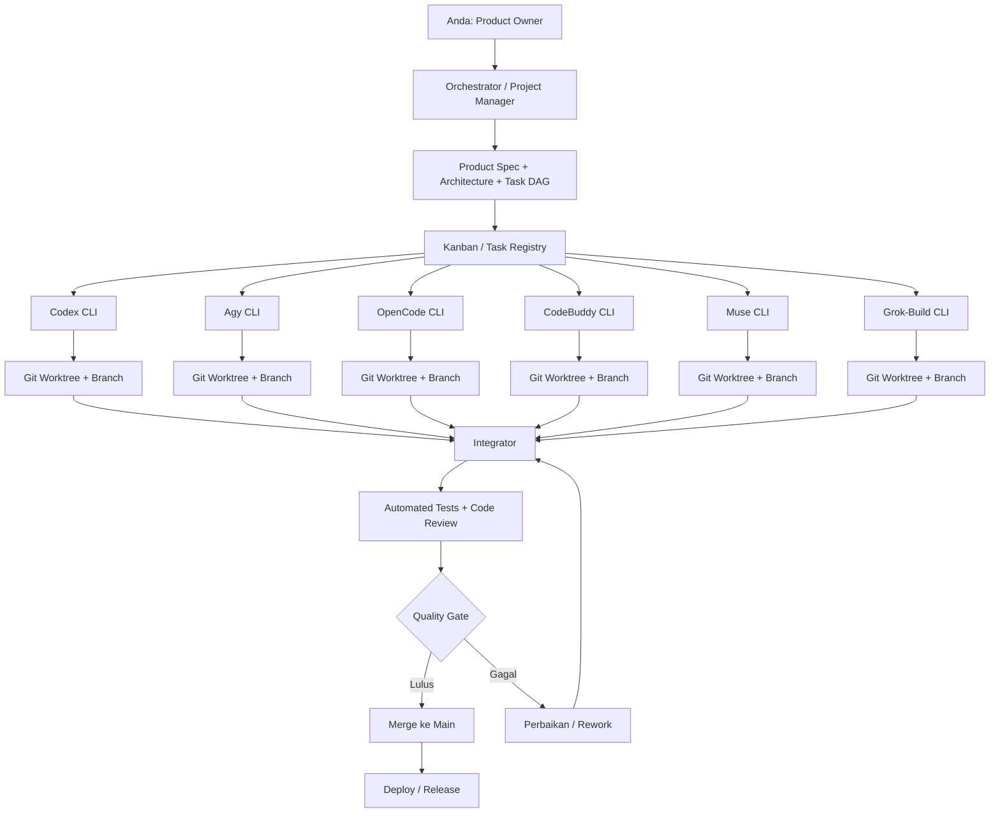
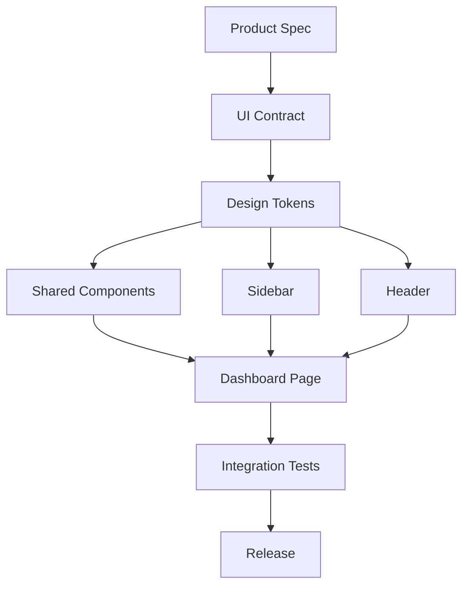

# Cara mengorkestrasi 6 AI coding agent untuk mengembangkan satu project software

Menurut saya, pendekatan yang paling cocok untuk kondisi Anda adalah **multi-agent software engineering dengan pola manager–worker, Git worktree, task dependency graph, dan CI sebagai quality gate**.

- **Parallel execution:** enam agent mengerjakan tugas masing-masing pada saat yang sama.
- **Multi-agent orchestration:** tugas dibagi, dependensi diatur, file yang boleh diubah ditentukan, hasil pekerjaan diintegrasikan, dan kualitas hasil diverifikasi.
- **Agentic software development lifecycle:** seluruh proses dari perencanaan, implementasi, pengujian, code review, sampai rilis dikelola sebagai satu alur kerja.

Anda membutuhkan pendekatan kedua dan ketiga, bukan hanya membuka enam terminal.

Saya menelusuri dokumentasi dan referensi tentang orkestrasi coding agent, Git worktree, serta platform multi-agent. Salah satu prinsip yang paling relevan datang dari dokumentasi resmi OpenAI: subagent cocok untuk pekerjaan yang independen, setiap tugas perlu memiliki pertanyaan dan hasil yang jelas, dan agent yang mengedit file yang sama harus berkoordinasi. [OpenAI Developers](https://developers.openai.com/api/docs/guides/agents-api/multi-agent?utm_source=chatgpt.com)

Berikut rancangan yang saya rekomendasikan untuk setup Anda.

## 1. Arsitektur yang saya rekomendasikan

Jangan jadikan salah satu model sebagai bos mutlak yang bebas menyuruh lima model lainnya mengubah kode. Jadikan **orchestrator sebagai pengelola alur kerja**, sedangkan keputusan teknis, implementasi, dan review dilakukan melalui tugas yang terstruktur.

Arsitekturnya seperti ini:



Diagram tersebut adalah rancangan yang saya sarankan, bukan klaim bahwa satu tool tertentu sudah menyediakan semua fungsi tersebut secara otomatis.

Ada lima komponen utama:

| Komponen | Fungsi | Contoh |
|---|---|---|
| Project management | Menyimpan backlog, status, prioritas, dan dependensi | GitHub Issues, Linear |
| Orchestrator | Membagi pekerjaan, menentukan urutan, menjalankan agent, dan mengumpulkan hasil | Script Python/Node.js atau framework orkestrasi |
| Agent runtime | Menjalankan masing-masing model melalui CLI yang sudah Anda gunakan | Herness CLI |
| Workspace isolation | Memisahkan perubahan kode setiap agent | Git worktree dan branch |
| Quality gate | Memastikan perubahan aman untuk digabungkan | Automated tests, lint, type checking, review |

**Poin terpenting:** Kanban tidak sama dengan orchestrator. Kanban mencatat apa yang harus dikerjakan dan statusnya. Orchestrator mengendalikan bagaimana pekerjaan tersebut benar-benar dieksekusi.

---

## 2. Metode yang tepat: gabungkan beberapa pendekatan

Saya tidak menyarankan menggunakan Scrum secara mentah, apalagi membuat enam agent menjalani sprint dengan ritual yang sama seperti enam manusia.

Lebih cocok menggunakan gabungan berikut.

### A. Kanban untuk mengelola aliran pekerjaan

Gunakan papan kerja dengan status:

`Backlog → Ready → Assigned → In Progress → Review → Integration → Done`

Tambahkan status `Blocked` untuk pekerjaan yang menunggu dependensi.

Setiap kartu pekerjaan harus memiliki:

- ID tugas yang unik.
- Tujuan dan kriteria penerimaan.
- Agent yang bertanggung jawab.
- File atau direktori yang boleh diubah.
- Dependensi terhadap tugas lain.
- Perintah pengujian yang harus dijalankan.
- Branch dan lokasi worktree.
- Status pekerjaan dan hasil validasi.

Contohnya:

| ID | Tugas | Agent | Dependensi | Status |
|---|---|---|---|---|
| UI-01 | Membuat design tokens dan tema | Codex | Tidak ada | In Progress |
| UI-02 | Membuat komponen Button dan Input | Agy | UI-01 | Ready |
| UI-03 | Membuat Sidebar dan navigasi | OpenCode | UI-01 | Ready |
| UI-04 | Membuat halaman Dashboard | CodeBuddy | UI-02, UI-03 | Blocked |
| UI-05 | Menulis integration tests | Muse | Kontrak UI tersedia | Ready |
| UI-06 | Review accessibility dan UI consistency | Grok-Build | Implementasi tersedia | Ready |

Ini contoh pembagian tugas, bukan rekomendasi berdasarkan benchmark kemampuan model-model tersebut.

Untuk pengelolaan issue, Linear menyediakan issue, workflow, relasi antartugas, serta integrasi GitHub. Namun, Anda tidak wajib menggunakannya jika GitHub Issues sudah cukup. [Linear](https://linear.app/docs/github-integration?utm_source=chatgpt.com)

### B. Task DAG untuk mengatur dependensi

Kanban menjawab, "Apa status tugas ini?"

**Task DAG (Directed Acyclic Graph)** menjawab, "Tugas mana yang bisa dimulai sekarang, dan mana yang harus menunggu?"

Misalnya, Anda ingin membuat dashboard admin.



Setelah `Design Tokens` selesai dan kontraknya disetujui, `Shared Components`, `Sidebar`, dan `Header` bisa dikerjakan secara paralel.

Dashboard baru dikerjakan setelah dependensi yang diperlukan tersedia.

Inilah kunci efisiensi multi-agent: **paralelkan pekerjaan yang independen, bukan pekerjaan yang sekadar berbeda nama tetapi sebenarnya saling bergantung.**

### C. Git worktree untuk isolasi kode

Ini bagian yang menurut saya wajib.

Dokumentasi resmi Git menjelaskan bahwa satu repository dapat memiliki beberapa working tree yang terhubung, sehingga beberapa branch bisa dikerjakan secara bersamaan tanpa harus terus-menerus berpindah branch dalam satu direktori. [Git](https://git-scm.com/docs/git-worktree?utm_source=chatgpt.com)

Contoh struktur direktori:

```text
my-project/
├── main/                     # Workspace integrasi utama
├── worktrees/
│   ├── ui-tokens/             # Codex
│   ├── shared-components/     # Agy
│   ├── sidebar/               # OpenCode
│   ├── dashboard-page/        # CodeBuddy
│   ├── integration-tests/     # Muse
│   └── ui-review/             # Grok-Build
└── .orchestrator/
    ├── project-spec.md
    ├── architecture.md
    ├── task-registry.json
    └── decisions.md
```

Direktori tersebut merupakan ilustrasi. Implementasinya bisa disesuaikan dengan struktur repository Anda.

Setiap agent mendapatkan workspace dan branch tersendiri. Agent mengerjakan tugasnya, menjalankan tes, kemudian menyerahkan hasilnya untuk di-review dan diintegrasikan.

Contoh membuat worktree:

```bash
git worktree add \
  -b agent/ui-tokens \
  ../worktrees/ui-tokens \
  main

git worktree add \
  -b agent/sidebar \
  ../worktrees/sidebar \
  main
```

Setelah itu, jalankan CLI yang sesuai di setiap direktori worktree.

```bash
cd ../worktrees/ui-tokens
# Jalankan perintah Codex CLI yang Anda gunakan

cd ../worktrees/sidebar
# Jalankan perintah OpenCode CLI yang Anda gunakan
```

Saya sengaja tidak mengarang perintah spesifik Herness CLI karena belum memverifikasi sintaks masing-masing CLI Anda.

**Aturan penting:** jangan biarkan beberapa agent menulis ke workspace yang sama secara bersamaan. Worktree mengurangi konflik perubahan file, tetapi tidak otomatis menyelesaikan konflik arsitektur, dependensi, atau API.

### D. CI sebagai quality gate

Setiap pekerjaan yang selesai harus melewati pemeriksaan sebelum digabungkan.

Contoh:

```text
Agent menyelesaikan tugas
        ↓
Periksa perubahan dan diff
        ↓
Jalankan lint dan type checking
        ↓
Jalankan unit tests
        ↓
Review kontrak dan integrasi
        ↓
Semua lolos?
    ├── Ya   → Siap merge
    └── Tidak → Kembali untuk perbaikan
```

GitHub mendukung status checks yang dapat dijadikan persyaratan sebelum perubahan digabungkan ke protected branch. [GitHub Docs](https://docs.github.com/en/pull-requests/reference/status-checks?utm_source=chatgpt.com)

Untuk proyek UI, pemeriksaannya sebaiknya mencakup:

- Lint dan type checking.
- Unit tests.
- Build aplikasi.
- Integration tests.
- Visual atau browser tests jika relevan.
- Pemeriksaan aksesibilitas.
- Review perubahan yang tidak sesuai spesifikasi.

Jangan menganggap laporan agent bahwa "semua tes lulus" sebagai bukti final. Orchestrator sebaiknya menjalankan ulang pemeriksaan penting secara independen.

---

## 3. Siapa yang menjadi Project Manager?

Ada dua pilihan utama.

### Pilihan 1: Satu agent menjadi coordinator

Salah satu model bertindak sebagai **manager agent** yang bertugas:

1. Membaca spesifikasi produk.
2. Memecah fitur menjadi tugas kecil.
3. Menentukan dependensi.
4. Menetapkan agent untuk setiap tugas.
5. Memantau status pekerjaan.
6. Mengumpulkan hasil dan mengidentifikasi konflik.
7. Meminta perbaikan jika hasil tidak sesuai kriteria.

Lima agent lainnya menjadi worker.

Kelebihannya adalah sederhana dan cepat diterapkan.

Kekurangannya: coordinator dapat membuat kesalahan perencanaan, menghabiskan banyak token, atau menjadi bottleneck jika semua keputusan harus melewatinya.

Karena Anda menggunakan beberapa CLI berbeda, saya tidak akan mengasumsikan bahwa coordinator dapat langsung mengendalikan semua CLI tanpa adapter tambahan.

### Pilihan 2: Orchestrator deterministik + agent sebagai worker

**Ini pilihan yang lebih saya rekomendasikan untuk setup Anda.**

Gunakan program kecil sebagai pengendali alur kerja. Program tersebut mengatur status, dependensi, workspace, dan pemeriksaan hasil. Model AI membantu merencanakan pekerjaan dan menulis kode, tetapi tidak menjadi satu-satunya sumber kebenaran tentang status proyek.

Pembagiannya:

| Tanggung jawab | Pengendali |
|---|---|
| Menentukan tujuan produk | Anda |
| Menyusun rencana awal | Manager agent |
| Memvalidasi struktur tugas | Orchestrator |
| Menentukan tugas yang siap | Task scheduler |
| Menjalankan CLI | Adapter setiap agent |
| Mengubah kode | Worker agent |
| Memeriksa hasil | Test runner dan reviewer |
| Menyetujui perubahan penting | Anda atau integrator dengan aturan eksplisit |
| Menggabungkan perubahan | Integrator |

Misalnya, manager agent menghasilkan sepuluh tugas. Orchestrator memvalidasi dependensinya, lalu menjalankan tiga tugas independen terlebih dahulu.

Ketika salah satu tugas selesai, hasil tes diperiksa. Jika lulus, perubahan tersebut dapat masuk ke antrean integrasi. Setelah dependensi terpenuhi, tugas berikutnya dijalankan.

Dengan pola ini, coordinator tidak perlu terus-menerus menghabiskan token hanya untuk menanyakan status kepada enam agent.

### Bagaimana dengan agent yang saling berkomunikasi?

Jangan jadikan percakapan bebas antarmodel sebagai mekanisme utama koordinasi.

Lebih baik gunakan kontrak yang eksplisit:

```text
Task UI-03
Status: In Progress
Owner: OpenCode
Branch: agent/sidebar
Workspace: worktrees/sidebar

Input:
- project-spec.md
- architecture.md
- UI contract v1

Allowed files:
- src/components/sidebar/**

Deliverables:
- Komponen Sidebar
- Unit tests
- Catatan perubahan

Acceptance criteria:
- Navigasi berfungsi
- Mendukung state aktif
- Tidak mengubah design tokens
- Semua tes yang relevan lulus

Handoff:
- Branch siap di-review
- Ringkasan implementasi
- Hasil perintah pengujian
- Daftar risiko atau pekerjaan tersisa
```

Agent lain tidak perlu mengetahui seluruh percakapan agent tersebut. Mereka hanya perlu mendapatkan spesifikasi, kontrak, dan hasil yang relevan.

Pola ini membantu mengurangi konteks yang tidak perlu dan mempermudah debugging jika terjadi kegagalan.

## 4. Tool orkestrasi yang layak Anda pertimbangkan

Saya menemukan beberapa pilihan yang relevan. Perlu dibedakan antara produk yang mengatur sesi coding agent, framework untuk membangun orchestrator sendiri, dan aplikasi yang hanya menjadi papan tugas.

### Opsi A — OpenHands Agent Canvas

Situs resmi: [OpenHands Agent Canvas](https://www.openhands.dev/product/canvas)

OpenHands memperkenalkan Agent Canvas sebagai workspace visual untuk menjalankan beberapa coding agent. Dokumentasinya menyebut dukungan untuk beberapa agent secara paralel, isolasi menggunakan Git worktree, serta kemampuan menghubungkan agent eksternal melalui Agent Client Protocol (ACP). [openhands.dev](https://www.openhands.dev/product/canvas?utm_source=chatgpt.com)

Yang menarik untuk kebutuhan Anda:

- Ada antarmuka visual untuk mengelola sesi agent.
- Sesi dapat menggunakan workspace terisolasi.
- Arsitekturnya memungkinkan agent eksternal terhubung melalui protokol.
- Anda dapat mempertahankan CLI dan mekanisme autentikasi yang sudah digunakan jika integrasinya sesuai.

**Tetapi ada batasan penting:** dokumentasi yang saya temukan secara eksplisit menyebut Codex, Claude Code, Gemini CLI, dan agent ACP-compatible. Saya belum memverifikasi bahwa keenam CLI Herness Anda bisa langsung dijalankan di Agent Canvas dengan autentikasi yang sekarang digunakan.

Karena itu, jangan berasumsi bahwa menginstal OpenHands otomatis membuat keenam agent siap berkolaborasi.

**Penilaian saya:** pilihan pertama yang layak Anda uji jika ingin antarmuka visual, tanpa harus langsung membangun semuanya sendiri.

### Opsi B — Orchestrator buatan sendiri

Bangun sebuah aplikasi kecil yang menjalankan CLI melalui subprocess.

Misalnya:

```text
agent-orchestrator/
├── orchestrator/
│   ├── scheduler
│   ├── dependency_resolver
│   ├── worktree_manager
│   ├── agent_runner
│   ├── test_runner
│   └── integration_manager
├── adapters/
│   ├── codex
│   ├── agy
│   ├── opencode
│   ├── codebuddy
│   ├── muse
│   └── grok-build
├── dashboard/
├── tasks/
└── config/
```

Ini adalah rancangan arsitektur, bukan repository atau framework yang sudah saya verifikasi keberadaannya.

Setiap adapter bertanggung jawab atas detail CLI tertentu, seperti:

- Cara menjalankan agent.
- Cara mengirim instruksi.
- Cara mendeteksi keberhasilan atau kegagalan.
- Cara menangani sesi interaktif.
- Cara menghentikan proses.
- Cara mengumpulkan hasil pekerjaan.

Sementara itu, scheduler tidak perlu mengetahui detail internal model. Ia hanya perlu mengetahui status tugas dan kemampuan adapter.

Sebagai contoh, sebuah task bisa memiliki kontrak:

```json
{
  "id": "UI-03",
  "agent": "opencode",
  "worktree": "../worktrees/sidebar",
  "depends_on": ["UI-01"],
  "allowed_paths": [
    "src/components/sidebar/**"
  ],
  "acceptance_criteria": [
    "Sidebar renders correctly",
    "Navigation works",
    "Tests pass"
  ],
  "status": "ready"
}
```

Contoh tersebut menunjukkan bentuk data yang bisa Anda gunakan. Nilai status, pemilihan agent, dan aturan eksekusi harus dikelola oleh program orkestrasi.

Keuntungan utamanya adalah Anda tidak perlu mengganti model ketika ingin mengganti cara pengelolaan proyek. Selama adapter suatu CLI berfungsi, CLI itu dapat menjadi worker.

Kekurangannya adalah Anda harus membangun dan merawat scheduler, adapter, pencatatan status, serta mekanisme pemulihan kegagalan sendiri.

**Penilaian saya:** paling fleksibel untuk jangka panjang, terutama jika keenam CLI Anda memiliki cara autentikasi dan interaksi yang berbeda.

### Opsi C — Protokol komunikasi agent

Jika Anda ingin membangun sistem yang dapat diperluas, pelajari [Agent Client Protocol](https://agentclientprotocol.com/) dan perhatikan juga proyek-proyek protokol untuk orkestrasi CLI.

ACP menyediakan standar komunikasi antara coding agent dan aplikasi klien. OpenHands, misalnya, menggunakan pendekatan ini untuk menghubungkan agent eksternal yang kompatibel. [GitHub](https://github.com/agentclientprotocol?utm_source=chatgpt.com)

Ada juga [CAP — CLI Agent Protocol](https://cap-protocol.org/), yang memosisikan dirinya sebagai protokol untuk mengendalikan dan mengorkestrasi berbagai CLI coding agent. Namun, referensi yang ditemukan menyebut spesifikasinya masih berupa draft pada 2026. Saya akan memperlakukannya sebagai opsi yang perlu dievaluasi, bukan fondasi produksi yang sudah terbukti cocok untuk seluruh setup Anda. [cap-protocol.org](https://cap-protocol.org/?utm_source=chatgpt.com)

Ada satu hal yang sering terlewat: **protokol komunikasi bukan project manager.**

Protokol dapat menyamakan cara menjalankan agent, tetapi tidak otomatis menentukan:

- Tugas mana yang harus dikerjakan terlebih dahulu.
- File mana yang boleh diubah.
- Kapan perubahan boleh di-merge.
- Apakah implementasi memenuhi kebutuhan produk.
- Bagaimana memulihkan proyek ketika beberapa tugas gagal.

Semua itu tetap memerlukan logika orkestrasi dan aturan proyek.

### Opsi D — GitHub Projects atau Linear sebagai papan kerja

Jika Anda ingin cepat mulai, saya akan memilih GitHub Projects terlebih dahulu, terutama jika kode Anda sudah disimpan di GitHub.

GitHub Projects mendukung tampilan board, table, dan roadmap, serta dapat menghubungkan issue dan pull request. Dokumentasi resminya juga menjelaskan bahwa tugas yang lebih kecil akan lebih mudah dikerjakan secara paralel dan menghasilkan pull request yang lebih mudah di-review. [GitHub Docs](https://docs.github.com/en/issues/planning-and-tracking-with-projects?ref=RemoteTools\&utm_source=chatgpt.com)

Alternatifnya, Linear cocok jika Anda lebih menyukai pengelolaan backlog dan workflow yang berorientasi produk.

Namun, kedua pilihan ini terutama menjadi **lapisan project management**. Anda tetap memerlukan mekanisme untuk menjalankan Herness CLI, membuat worktree, memantau proses, dan memvalidasi hasil.

Berikut ringkasannya.

| Pilihan | Papan tugas | Menjalankan agent | Isolasi workspace | Fleksibilitas lintas CLI |
|---|---|---|---|---|
| GitHub Projects | Ya | Perlu mekanisme tambahan | Melalui Git/worktree | Tinggi jika adapter dibuat |
| Linear | Ya | Ada fitur coding session tertentu, tetapi bukan jaminan dukungan Herness CLI | Bergantung pada runner | Perlu verifikasi integrasi |
| OpenHands Agent Canvas | Bukan pengganti penuh issue tracker | Ya, untuk agent yang didukung | Git worktree didukung | Bergantung pada kompatibilitas |
| Orchestrator sendiri | Bisa dibuat | Ya, melalui adapter | Bisa dibuat berbasis worktree | Paling fleksibel secara desain |

Untuk Linear, perlu dicatat bahwa fitur Coding Sessions yang tersedia saat ini memiliki dukungan dan ketentuan paket tersendiri. Saya tidak menyarankannya sebagai asumsi jalur gratis untuk menjalankan enam CLI Anda. [Linear](https://linear.app/docs/coding-sessions?utm_source=chatgpt.com)

---

## 5. Bagaimana mengembangkan UI secara paralel tanpa membuat hasilnya berantakan?

Ini bagian yang paling penting untuk kasus Anda.

Kesalahan yang harus dihindari adalah memberikan instruksi kepada keenam agent seperti:

> Buat UI dashboard yang bagus, modern, dan konsisten.

Jika keenam agent mengerjakan dashboard dengan kebebasan penuh, mereka mungkin menghasilkan enam desain, enam pendekatan routing, struktur komponen berbeda, dan aturan styling yang tidak konsisten.

Lebih baik gunakan pola **contract-first development**.

### Tahap 1 — Tetapkan spesifikasi dan kontrak UI

Sebelum worker mulai menulis kode, tentukan:

- Framework dan struktur aplikasi.
- Design tokens.
- Typography dan spacing.
- Aturan komponen bersama.
- Routing.
- State management.
- Kontrak API.
- Struktur folder.
- Kriteria penerimaan.

Contoh:

```text
DESIGN CONTRACT v1

Framework:
- React + TypeScript

Styling:
- Gunakan sistem styling yang telah ditentukan proyek.

Design tokens:
- Warna utama dan warna netral didefinisikan secara terpusat.
- Spacing menggunakan skala yang konsisten.
- Typography menggunakan token yang disepakati.

Components:
- Button
- Input
- Modal
- Sidebar
- Header

Rules:
- Jangan membuat design tokens baru di masing-masing halaman.
- Jangan mengubah routing tanpa persetujuan.
- Jangan mengubah kontrak komponen bersama tanpa memperbarui dependensi.
```

Teknologi pada contoh tersebut hanya ilustrasi. Kontrak sebenarnya harus mengikuti stack proyek Anda.

### Tahap 2 — Pisahkan tugas berdasarkan ownership

Contoh pembagian:

| Agent | Fokus pekerjaan | Batas kepemilikan |
|---|---|---|
| Codex | Design tokens dan fondasi UI | Theme dan konfigurasi desain |
| Agy | Shared components | Button, Input, Modal |
| OpenCode | Sidebar dan navigasi | Komponen navigasi |
| CodeBuddy | Halaman dashboard | File halaman dashboard |
| Muse | Testing dan test utilities | Direktori testing |
| Grok-Build | Review desain dan implementasi | Review report; perubahan kode hanya melalui tugas terpisah |

Pembagian ini adalah titik awal, bukan pembagian permanen. Setelah beberapa proyek, Anda bisa menggunakan data hasil pekerjaan untuk menentukan agent yang paling cocok untuk setiap jenis tugas.

Satu aturan yang sangat membantu: **setiap file penting sebaiknya memiliki satu pemilik penulis pada satu waktu.**

Dua agent boleh membaca file yang sama, tetapi jika keduanya perlu mengubah file yang sama, jadwalkan pekerjaan secara berurutan atau tentukan batas edit yang tidak tumpang tindih.

### Tahap 3 — Gunakan kontrak komponen yang eksplisit

Misalnya, sebelum agent halaman dashboard mulai bekerja, kontrak komponen Button harus sudah jelas:

```tsx
type ButtonProps = {
  variant?: "primary" | "secondary" | "danger";
  size?: "sm" | "md" | "lg";
  disabled?: boolean;
  onClick?: () => void;
  children: React.ReactNode;
};
```

Ini hanya contoh kontrak TypeScript, bukan implementasi komponen yang harus digunakan apa adanya.

Agent dashboard dapat menggunakan kontrak tersebut tanpa harus menunggu seluruh implementasi Button selesai, asalkan kontraknya telah disetujui dan tersedia sebagai referensi bersama.

Dengan cara ini, tim bisa mengerjakan komponen dan halaman secara paralel tanpa masing-masing agent menciptakan API yang berbeda.

### Tahap 4 — Integrasikan perubahan secara bertahap

Jangan menunggu keenam agent selesai baru mulai menggabungkan kode.

Gunakan urutan:

1. Fondasi dan kontrak disetujui.
2. Komponen dasar selesai dan dites.
3. Komponen dinyatakan siap digunakan.
4. Halaman yang bergantung pada komponen mulai diintegrasikan.
5. Tes integrasi dijalankan.
6. Konflik dan ketidaksesuaian diperbaiki.
7. Build final divalidasi.

Perhatikan bahwa Git worktree tidak menjamin integrasi otomatis. Dua branch tetap dapat menghasilkan konflik ketika digabungkan. Bahkan ketika Git berhasil melakukan merge, API atau perilaku kedua implementasi masih mungkin tidak cocok.

Karena itu, keberhasilan merge harus diikuti pemeriksaan integrasi.

---

## 6. Rekomendasi utama: mulai dengan sistem hybrid

Kalau saya berada di posisi Anda, saya tidak akan langsung membangun platform orkestrasi yang kompleks.

Saya akan mulai dengan tiga lapisan yang bisa dikembangkan secara bertahap.

### Lapisan 1 — GitHub Projects sebagai pusat manajemen

Gunakan GitHub Projects untuk:

- Product backlog.
- Kanban.
- Prioritas tugas.
- Status pekerjaan.
- Relasi dependensi.
- Issue dan pull request.
- Riwayat keputusan melalui diskusi dan dokumentasi.

Setiap pekerjaan yang diberikan kepada agent harus memiliki satu ID tugas.

Contoh penamaan:

```text
PROJ-001  Project foundation
PROJ-002  Design system
PROJ-003  Shared components
PROJ-004  Dashboard layout
PROJ-005  API integration
PROJ-006  Integration testing
PROJ-007  Release preparation
```

Untuk memulai, Anda tidak perlu menambahkan Notion. Jika semua informasi proyek sudah tersedia di GitHub, menambahkan aplikasi lain justru bisa menimbulkan dua sumber kebenaran.

**Prinsipnya: satu sumber kebenaran untuk status tugas, spesifikasi, dan hasil pekerjaan.**

### Lapisan 2 — Orchestrator lokal

Bangun orchestrator kecil dengan Python atau Node.js.

Untuk tahap awal, cukup implementasikan enam fungsi:

1. Membaca tugas yang berstatus `Ready`.
2. Memeriksa dependensi tugas.
3. Membuat branch dan Git worktree.
4. Menjalankan Herness CLI melalui adapter yang sesuai.
5. Memeriksa hasil pekerjaan dan tes.
6. Memperbarui status tugas.

Gambaran prosesnya:

```text
                    ┌──────────────────┐
                    │ GitHub Projects  │
                    │ Task Registry    │
                    └────────┬─────────┘
                             │
                             ▼
                    ┌──────────────────┐
                    │    Scheduler     │
                    │ Dependency Check │
                    └────────┬─────────┘
                             │
                  Tugas independen tersedia
                             │
             ┌───────────────┼───────────────┐
             ▼               ▼               ▼
        ┌─────────┐     ┌─────────┐     ┌─────────┐
        │ Codex   │     │ Agy     │     │ OpenCode│
        │ Adapter │     │ Adapter │     │ Adapter │
        └────┬────┘     └────┬────┘     └────┬────┘
             │               │               │
             ▼               ▼               ▼
        Worktree 1      Worktree 2      Worktree 3
             │               │               │
             └───────────────┼───────────────┘
                             ▼
                    ┌──────────────────┐
                    │ Validation Queue │
                    │ Tests + Review   │
                    └────────┬─────────┘
                             ▼
                    ┌──────────────────┐
                    │ Integration Gate │
                    └────────┬─────────┘
                             ▼
                         Git Main
```

Tiga agent di diagram hanyalah contoh; sistem sebenarnya dapat menangani keenam agent Anda.

Mulailah dengan menjalankan dua atau tiga agent terlebih dahulu. Setelah scheduler, isolasi workspace, dan validasi berfungsi dengan baik, baru tingkatkan menjadi enam agent.

### Lapisan 3 — Dashboard monitoring

Setelah orkestrasi dasar berjalan, tambahkan dashboard yang menampilkan:

| Informasi | Contoh |
|---|---|
| Agent | Codex |
| Task | PROJ-002 |
| Status | In Progress |
| Worktree | `worktrees/design-system` |
| Durasi | Waktu sejak proses dimulai |
| Progress | Menunggu, berjalan, atau selesai |
| Validation | Belum dijalankan, lulus, atau gagal |
| Git branch | `agent/design-system` |
| Handoff | Belum siap atau siap direview |
| Error | Timeout, CLI gagal, atau tes gagal |

Dashboard ini nantinya bisa menjadi pusat kendali Anda. Anda tidak perlu membuka satu per satu keenam terminal hanya untuk mengetahui pekerjaan yang sedang berjalan.

Namun, jangan mengandalkan persentase kemajuan yang dilaporkan model sebagai ukuran objektif. Status seperti `running`, `tests passed`, `branch created`, dan `merged` sebaiknya didasarkan pada peristiwa yang benar-benar diamati oleh orchestrator.

---

## 7. Bagaimana menangani enam agent dengan kemampuan dan CLI berbeda?

Ini tantangan khusus dalam setup Anda.

Codex, Agy, OpenCode, CodeBuddy, Muse, dan Grok-Build tidak boleh diasumsikan memiliki cara menjalankan tugas, format output, atau kemampuan otomasi yang sama.

Karena Anda ingin mempertahankan akses token gratis melalui masing-masing CLI, saya menyarankan pendekatan **adapter per CLI**.

### Contoh kontrak adapter

Secara konseptual, setiap adapter menyediakan antarmuka yang sama:

```python
class AgentAdapter:
    def start_task(self, task, workspace):
        """Menjalankan tugas di workspace yang ditentukan."""
        raise NotImplementedError

    def get_status(self, task_id):
        """Mengambil status proses atau tugas."""
        raise NotImplementedError

    def stop_task(self, task_id):
        """Menghentikan proses jika diperlukan."""
        raise NotImplementedError

    def collect_result(self, task_id):
        """Mengumpulkan ringkasan, diff, dan hasil validasi."""
        raise NotImplementedError
```

Ini adalah contoh desain antarmuka, bukan implementasi yang sudah terhubung dengan CLI Anda.

Masing-masing adapter harus menangani perbedaan nyata pada CLI bersangkutan.

Misalnya, jika satu CLI dapat menerima instruksi melalui argumen noninteraktif, gunakan mekanisme tersebut. Jika CLI lain memerlukan sesi terminal interaktif, adapter-nya harus menangani PTY dan deteksi penyelesaian sesi.

Jangan memaksakan satu pola eksekusi yang sama jika kemampuan CLI berbeda.

### Sebelum mengintegrasikan adapter, lakukan inventarisasi

Untuk setiap CLI, verifikasi:

| Hal yang diperiksa | Mengapa penting |
|---|---|
| Perintah menjalankan CLI | Menentukan cara memulai agent |
| Mode noninteraktif | Memungkinkan otomasi |
| Mode interaktif | Diperlukan jika CLI tidak mendukung eksekusi otomatis |
| Cara mengirim instruksi | Menentukan mekanisme pemberian tugas |
| Cara mendeteksi proses selesai | Mencegah scheduler salah menganggap tugas selesai |
| Dukungan pembatasan workspace | Mengurangi risiko perubahan di luar tugas |
| Dukungan autentikasi | Memastikan akun yang benar digunakan |
| Cara menghentikan proses | Diperlukan untuk timeout dan pembatalan |
| Format output | Mempermudah pencatatan hasil |
| Batas penggunaan | Menentukan concurrency yang realistis |

**Saya belum memverifikasi secara langsung keenam CLI Herness yang Anda sebutkan**, jadi saya tidak akan mengklaim semuanya mendukung mode noninteraktif, API terstruktur, atau integrasi ACP.

Itulah salah satu pekerjaan pertama yang harus dilakukan sebelum membangun scheduler yang sesungguhnya.

### Apakah perlu menggunakan MCP atau A2A?

Untuk tahap awal, saya tidak akan menjadikan keduanya sebagai persyaratan.

MCP dapat berguna jika agent perlu mengakses tools atau sumber data yang dibagikan. Protokol komunikasi agent dapat berguna jika Anda ingin membangun komunikasi antarsistem yang lebih terstruktur.

Namun, Anda bisa memulai dengan cara yang lebih sederhana:

- Scheduler mengelola status.
- File tugas menyimpan instruksi.
- Git menyimpan kode dan riwayat perubahan.
- Worktree memisahkan pekerjaan.
- CLI menjalankan model.
- Test runner memvalidasi hasil.

Tambahkan protokol yang lebih kompleks hanya jika terdapat kebutuhan nyata yang tidak bisa dipenuhi dengan mekanisme tersebut.

---

## 8. Bagaimana mengatur sprint jika agent bekerja terus-menerus?

Saya tetap menyarankan menggunakan konsep sprint, tetapi tidak harus mengikuti ritual Scrum secara penuh.

Gunakan **sprint untuk menetapkan target produk, sedangkan Kanban mengatur aliran tugas harian**.

Contohnya, Sprint 1 memiliki tujuan:

> Membuat fondasi UI dashboard yang dapat dijalankan, memiliki design system, dan siap dikembangkan lebih lanjut.

Backlog sprint tersebut bisa berisi:

- Menetapkan arsitektur UI.
- Membuat design tokens.
- Membuat shared components.
- Membuat layout dashboard.
- Menambahkan navigasi.
- Menulis integration tests.
- Menyiapkan CI.

Anda tidak perlu menyuruh keenam agent mengikuti daily stand-up. Cukup sediakan mekanisme pelaporan terstruktur.

Misalnya, setiap agent menghasilkan:

```text
TASK REPORT

Task ID:
Status:
Files changed:
Commit / branch:
Tests executed:
Tests passed:
Tests failed:
Blockers:
Next action:
```

Orchestrator mengumpulkan laporan tersebut, kemudian menampilkan ringkasan seperti:

```text
SPRINT STATUS

Completed:      4 tasks
In progress:    3 tasks
Blocked:        1 task
Needs review:   2 tasks
Failed checks:  1 task

Main blocker:
Shared component contract is not finalized.
```

Angka di atas hanya contoh tampilan, bukan hasil pengukuran proyek Anda.

Dengan begitu, Anda tetap memperoleh visibilitas seperti pada tim manusia tanpa harus menjalankan ritual rapat untuk setiap agent.

### Bagaimana menentukan kapan sprint selesai?

Jangan menggunakan jumlah tugas yang sudah ditandai selesai sebagai satu-satunya ukuran.

Sprint sebaiknya dinyatakan selesai jika:

1. Kriteria penerimaan terpenuhi.
2. Perubahan yang dibutuhkan telah diintegrasikan.
3. Tes yang relevan lulus.
4. Tidak ada blocker kritis yang belum ditangani.
5. Hasil produk dapat dijalankan dan diperiksa.

Agent yang menyelesaikan sepuluh tugas kecil belum tentu menghasilkan lebih banyak nilai daripada agent yang menyelesaikan satu fitur end-to-end.

---

## 9. Risiko terbesar: enam agent justru bisa lebih lambat daripada dua

Ini penting untuk dipertimbangkan sejak awal.

Menambah jumlah agent tidak otomatis meningkatkan produktivitas. Sebagian pekerjaan memiliki dependensi yang tidak dapat diparalelkan, dan integrasi membutuhkan waktu.

Ada beberapa risiko utama.

**Pertama, konflik kode.** Dua agent mungkin mengubah komponen bersama atau konfigurasi yang sama. Gunakan ownership, worktree, dan kontrak file.

**Kedua, konflik desain.** Implementasi mungkin berhasil secara teknis tetapi tidak konsisten secara visual. Tetapkan design tokens dan komponen bersama sebelum membagi tugas UI.

**Ketiga, overhead integrasi.** Jika terlalu banyak pekerjaan dilakukan secara bersamaan, Anda mungkin menghabiskan waktu lebih banyak untuk memperbaiki konflik daripada mengembangkan fitur.

**Keempat, duplikasi pekerjaan.** Dua agent mungkin mengimplementasikan solusi berbeda untuk masalah yang sama. Gunakan ID tugas, daftar file yang dimiliki, dan status yang dapat diperiksa.

**Kelima, kehabisan konteks atau kegagalan CLI.** Orchestrator harus dapat menyimpan status dan melanjutkan pekerjaan setelah proses gagal, tanpa menganggap tugas otomatis selesai.

**Keenam, penggunaan token.** Enam agent tidak selalu membutuhkan concurrency enam. Batasi jumlah proses aktif dan prioritaskan pekerjaan yang membuka dependensi berikutnya.

### Mulai dengan batas concurrency

Saya akan memulai seperti ini:

| Jenis pekerjaan | Concurrency awal |
|---|---:|
| Analisis dan perencanaan | 1–2 agent |
| Implementasi komponen independen | 2–3 agent |
| Integrasi dan perbaikan | 1–2 agent |
| Review independen | 1 agent |
| Maksimum proses coding aktif | 3 |

Angka tersebut adalah rekomendasi awal untuk eksperimen, bukan benchmark universal.

Setelah beberapa tugas, ukur waktu penyelesaian, tingkat kegagalan, konflik merge, dan jumlah pekerjaan ulang. Jika tiga agent menghasilkan aliran pekerjaan yang stabil, naikkan concurrency secara bertahap.

Anda ingin mengoptimalkan **fitur yang berhasil diintegrasikan per satuan waktu**, bukan sekadar jumlah agent yang aktif.

---

## 10. Roadmap implementasi yang saya sarankan

Berikut urutan implementasi yang realistis.

### Fase 1 — Manual orchestration

Mulai tanpa membangun software orchestrator.

- Buat GitHub Projects.
- Tetapkan aturan penulisan task.
- Gunakan branch dan worktree.
- Jalankan dua atau tiga CLI secara manual.
- Integrasikan perubahan melalui pull request atau branch review.
- Catat konflik dan kegagalan.

Tujuan fase ini adalah menemukan workflow yang benar sebelum mengotomatisasi proses yang belum stabil.

### Fase 2 — Semi-automatic orchestration

Bangun scheduler sederhana yang mampu:

- Membaca daftar tugas.
- Memeriksa dependensi.
- Membuat worktree.
- Menjalankan CLI melalui adapter.
- Mencatat log.
- Memeriksa hasil tes.
- Memperbarui status.

Pada fase ini, keputusan merge masih dilakukan manusia.

### Fase 3 — Quality gate dan integrasi otomatis

Tambahkan:

- CI.
- Pemeriksaan branch.
- Validasi hasil tugas.
- Deteksi konflik.
- Antrean integrasi.
- Retry untuk kegagalan yang aman diulang.
- Mekanisme menghentikan proses yang macet.

Jangan langsung mengaktifkan auto-merge untuk semua perubahan. Mulai dari tugas kecil dan berisiko rendah.

### Fase 4 — Dashboard dan manajemen lintas proyek

Setelah alur dasarnya stabil, tambahkan:

- Dashboard status.
- Pemilihan agent berdasarkan jenis tugas.
- Riwayat pekerjaan.
- Monitoring penggunaan.
- Penjadwalan lintas proyek.
- Evaluasi kualitas hasil setiap agent.

Pada fase ini, Anda bisa mempertimbangkan apakah OpenHands Agent Canvas dapat menggantikan sebagian antarmuka yang ingin Anda bangun sendiri.

---

## 11. Kesimpulan: apa yang sebaiknya Anda gunakan?

Saya akan memilih kombinasi berikut:

| Kebutuhan | Pilihan saya |
|---|---|
| Metodologi | Kanban + task DAG + sprint berbasis target |
| Project manager | Orchestrator deterministik, dibantu manager agent |
| Task tracker | GitHub Projects |
| Source of truth | Repository Git dan dokumen spesifikasi |
| Isolasi pekerjaan | Git worktree + branch per tugas |
| Eksekusi model | Herness CLI yang sudah Anda gunakan |
| Integrasi CLI | Adapter per agent |
| Validasi | Automated tests + CI + review |
| Integrasi kode | Antrean merge dengan quality gate |
| Dashboard | Tambahkan setelah workflow dasar stabil |

Referensi implementasi yang paling layak Anda pelajari lebih lanjut:

1. [Git Worktree — dokumentasi resmi Git](https://git-scm.com/docs/git-worktree)
2. [GitHub Projects](https://docs.github.com/en/issues/planning-and-tracking-with-projects)
3. [OpenAI Multi-agent Guide](https://developers.openai.com/api/docs/guides/agents-api/multi-agent)
4. [Agent Client Protocol](https://agentclientprotocol.com/)
5. [CAP — CLI Agent Protocol](https://cap-protocol.org/)

### Satu pertanyaan penting sebelum menentukan implementasi teknis

**Herness CLI yang Anda gunakan itu menjalankan keenam agent langsung di terminal lokal Mac Anda, dan masing-masing bisa dijalankan melalui perintah CLI biasa, atau ada yang harus dijalankan lewat sesi interaktif di aplikasi Herness?**

Ini menentukan apakah saya sebaiknya merekomendasikan orchestrator berbasis subprocess biasa, pengendalian terminal interaktif, atau mencoba memanfaatkan protokol integrasi yang sudah tersedia.