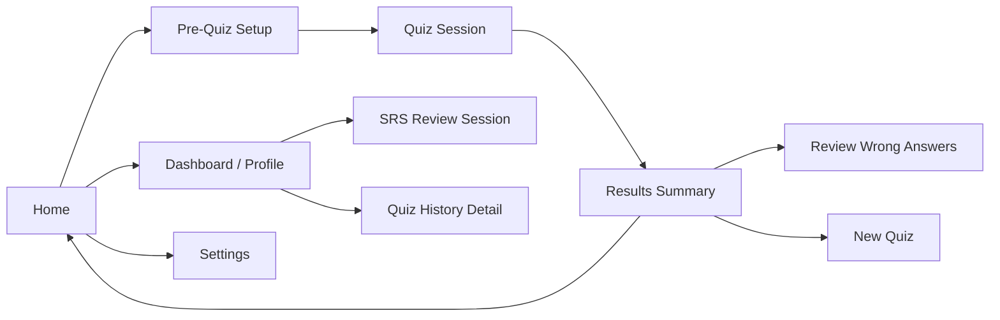

# PRD — IELTS & TOEIC Preps

### Offline macOS Desktop Quiz App for B1–B2 Vocabulary, Reading & Writing

| | |
|---|---|
| **Product** | IELTS & TOEIC Preps |
| **Version** | 1.0 (v1 / MVP) |
| **Status** | Draft for review |
| **Platform** | macOS desktop only (Apple Silicon & Intel) |
| **Owner** | Product Owner (Rizky Eky) |
| **Prepared by** | IT Consultant (AI-assisted) |
| **Date** | Oct 2026 |

---

## 1. Overview

A fully offline macOS quiz application for English exam preparation (IELTS/TOEIC-style),
focused on **Vocabulary, Reading, and Writing** practice at **B1–B2 levels**. No speaking or
listening.

All content lives in plain-text files (JSON / CSV / Markdown) inside an editable content
folder, so the question bank is **easy to extend and edit by humans or AI assistants**
without touching app code.

UI/UX is a **Duolingo + Quizlet + Kahoot hybrid** (see `design/DESIGN.md`): a clean, card-first
layout with thick tactile borders, hard "3D" shadows, spring micro-animations, and instant
feedback, in a trustworthy blue palette with a playful yellow highlight for score and
achievement. Professional for B1–B2, **without gamification pressure (no streaks, no XP, no
hearts)**.

**Core value:** the user can add thousands of new words/passages just by dropping files or
asking an AI to generate them in a strict schema. No internet required to run.

---

## 2. Goals & Non-Goals

### 2.1 Goals (v1)
- Practice **Vocabulary, Reading, Writing** in separate sessions (never mixed).
- Support difficulty levels: **B1 Core, B1+, B2 Core, B2 Mastery**.
- **100% offline** — zero network calls, zero telemetry, single local user.
- Content pipeline: add/edit questions by editing plain files; AI-friendly schemas.
- Track local progress: daily activity, quiz scores, vocabulary mastery (SRS).
- Polished feel: instant answer feedback, smooth animations, light/dark mode.
- Native macOS feel: system appearance, responsive window.

### 2.2 Non-Goals (v1)
- ❌ Speaking & Listening exercises (no audio).
- ❌ Online accounts, sync, multiplayer, leaderboards, streaks, XP, hearts.
- ❌ iOS / iPadOS / Windows / Linux builds.
- ❌ Built-in content editor GUI (editing is done via files).
- ❌ AI-in-the-app / online grading (AI is used offline, by the owner, to author content files).

---

## 3. Target User & Difficulty System

**Single local user** — an Indonesian English learner preparing for IELTS/TOEIC at B1–B2
level, practicing 15–30 minutes per day on a Mac.

- UI language: **English (full)**.
- Vocabulary reviews include **Indonesian translations** as a learning aid.
- One profile, stored locally, no login.

**Difficulty ladder (PO-defined):**

| Level | CEFR equivalent | Vocab source | Reading complexity |
|---|---|---|---|
| B1 Core | B1 low | Oxford 3000 B1 (core 800) | 180–220 words, 1 idea per paragraph |
| B1+ | B1 high / B2 low | Oxford 3000 B1+ + TOEIC 600 | 220–280 words, 2 inferences |
| B2 Core | B2 low | Oxford 5000 B2 (core) + Academic Word List | 280–350 words, complex sentences |
| B2 Mastery | B2 high | Oxford 5000 B2 + C1 bridge, IELTS band 6.5–7 vocab | 350–450 words, abstract topics |

The user selects difficulty in Pre-Quiz Setup; difficulty filters content by the `level` field.

---

## 4. Tech Stack & Architecture

| Layer | Choice | Notes |
|---|---|---|
| Shell | **Tauri 2.x (Rust)** | macOS 13+, window, fs, store, system font detection |
| Frontend | **Svelte 5 + TypeScript** (Runes: `$state`, `$derived`) | Vite build |
| UI Kit | **shadcn-svelte + Tailwind CSS** + lucide-svelte icons | Design tokens in §10 |
| Animation | Svelte transitions + CSS keyframes (optionally svelte-motion) | No heavy animation libs |
| Persistence | **tauri-plugin-store** + `plugin-fs` (JSON files) | Robust across WebView updates |
| Content | JSON / CSV / MD files | Loaded from user-editable folder (§6) |
| Validation | Zod schemas at load time | Invalid files quarantined + warning toast |

**Networking:** the app makes no network requests of any kind. CSP blocks all network;
Tauri allowlist limited to `fs`, `dialog`, `path`.

**Project structure:**

```
/src
  /lib
    /components/ui            (shadcn)
    /components/quiz          (VocabCard, ReadingPassage, MatchingGrid, ClozeInput, HighlightPassage, WritingEditor)
    /stores                   (quiz, settings, progress, srs)
    /types                    (schema.ts)
    /utils                    (srs.ts, parser.ts, fs.ts)
    /content-loader           (loads md/json/csv)
  /routes
    /                         (homepage)
    /quiz/[mode]
    /result
    /dashboard
    /settings
/src-tauri
  /resources/content/         (bundled seed)
    /vocab/                   (vocab-b1-core.csv, vocab-b2-core.json, ...)
    /reading/                 (passages/*.md, questions/*.json)
    /writing/                 (prompts.json, images/)
```

---

## 5. App Flow



---

## 6. Content Architecture (Question Bank)

### 6.1 Folder location & seeding
- On first launch, bundled seed content is **copied to the user's content folder**:
  `~/Library/Application Support/com.ielts-toeic-preps/content/`
- The app reads content **live from this folder** — edits take effect on next launch or via
  the **"Reload Content"** button in Settings.
- Settings includes **"Open Content Folder"** (opens Finder) so the owner or an AI agent can
  edit files directly.
- Files failing schema validation are **skipped and reported** (warning toast) — never crash.
- Optional: a file watcher (`notify` crate) can auto-reload on change.

### 6.2 Directory layout

```
content/
├── vocab/
│   ├── vocab-b1-core.csv
│   ├── vocab-b1-plus.json
│   ├── vocab-b2-core.csv
│   └── vocab-b2-mastery.json
├── reading/
│   ├── passages/
│   │   ├── remote-work.md
│   │   └── urban-farming.md
│   └── questions/
│       ├── remote-work.json
│       └── urban-farming.json
└── writing/
    ├── prompts.json
    └── images/                 # describe-the-picture prompts
        └── street-market.jpg
```

### 6.3 Vocab schema (JSON and CSV both accepted)

JSON entry:
```json
{
  "id": "abundant",
  "word": "abundant",
  "pos": "adjective",
  "level": "b2-core",
  "topic": "environment",
  "definition_en": "existing in large quantities; more than enough",
  "definition_id": "berlimpah; jumlahnya banyak",
  "example_en": "The region has abundant supplies of fresh water.",
  "example_id": "Wilayah itu memiliki pasokan air tawar yang melimpah.",
  "synonyms": ["plentiful", "ample"],
  "antonyms": ["scarce"],
  "distractors": ["ample", "scattered", "fragile"],
  "collocations": ["abundant supplies"],
  "source": "oxford_5000",
  "mastery_level": 0
}
```

CSV columns (same fields, one row per word):
```csv
id,word,pos,level,topic,definition_en,definition_id,example_en,example_id,synonyms,antonyms,distractors,source
abundant,abundant,adjective,b2-core,environment,"existing in large quantities; more than enough","berlimpah","The region has abundant supplies of fresh water.","Wilayah itu memiliki pasokan air tawar yang melimpah.","plentiful;ample","scarce","ample;scattered;fragile",oxford_5000
```

**Rules**
- `level` ∈ `b1-core | b1-plus | b2-core | b2-mastery`
- `id` is unique, kebab-case, stable (used by SRS & history).
- `distractors` are **optional**. If omitted, MCQ/True-False **distractors are auto-generated
  at runtime** from other words in the same level/POS pool. Explicit distractors always win.
- CSV uses semicolons for list fields; parser via PapaParse.

### 6.4 Reading passage schema (Markdown, frontmatter + body)

```markdown
---
id: remote-work
title: The Rise of Remote Work
level: b2-core
topic: technology
---
Passage body text goes here. Sentences are split by the app for the
highlight-interaction question type. A gap for sentence-completion
questions is marked with [[GAP:1]] inline.
```

Parser: gray-matter for frontmatter, body treated as the passage.

### 6.5 Reading questions schema (JSON, linked by `passage_id`)

```json
{
  "passage_id": "remote-work",
  "items": [
    {
      "id": "rw-q1",
      "type": "sentence_completion",
      "gap": 1,
      "options": [
        "Companies report higher productivity when employees choose their location.",
        "Most employees prefer commuting to working from home.",
        "Remote work has disappeared since the pandemic.",
        "Offices have become larger in recent years."
      ],
      "answer": 0,
      "explanation_en": "The sentence must contrast with the following claim.",
      "explanation_id": "Kalimat ini harus bertentangan dengan klaim berikutnya."
    },
    {
      "id": "rw-q2",
      "type": "highlight_idea",
      "variant": "tap_sentence",
      "prompt": "Select the sentence that expresses a CONTRAST between two views.",
      "answer_sentences": [2],
      "answer_text": "However, isolation remains a challenge."
    },
    {
      "id": "rw-q3",
      "type": "highlight_idea",
      "variant": "choose_idea",
      "sentence": 4,
      "prompt": "Which idea does the highlighted sentence express?",
      "options": ["Cause and effect", "Comparison", "Prediction", "Concession"],
      "answer": 1
    },
    {
      "id": "rw-q4",
      "type": "best_title",
      "options": [
        "Why Working From Home Is Here to Stay",
        "A History of Office Design",
        "The Failure of Remote Work",
        "How to Commute Faster"
      ],
      "answer": 0
    }
  ]
}
```

### 6.6 Writing prompts schema (JSON)

```json
{
  "items": [
    {
      "id": "wr-001",
      "type": "sentence_order",
      "level": "b2-core",
      "words": ["although", "the", "report", "was", "long", "it", "was", "clear"],
      "correct": "Although the report was long, it was clear.",
      "alternatives": [],
      "grammar_focus": "concession clause"
    },
    {
      "id": "wr-002",
      "type": "grammar_fix",
      "level": "b2-mastery",
      "sentence": "She suggested him to apply for the scholarship.",
      "accepted": [
        "She suggested that he apply for the scholarship.",
        "She suggested he apply for the scholarship."
      ],
      "hint": "verb pattern: suggest",
      "explanation_id": "Setelah 'suggest' gunakan 'that + subjek + bare infinitive'."
    },
    {
      "id": "wr-003",
      "type": "image_description",
      "level": "b2-core",
      "image": "images/street-market.jpg",
      "prompt": "Describe what is happening in the picture (2–3 sentences).",
      "model_answer": "A vendor is selling fresh vegetables at a busy street market. Customers are browsing the stalls while carrying baskets.",
      "keywords": ["vendor", "selling", "market", "customers"],
      "self_score_max": 5
    }
  ]
}
```

### 6.7 Data pipeline (AI-editable)
All content files are validated against JSON Schema / Zod on app start. If invalid, the app
shows an error toast and skips the file — it never crashes.

1. `vocab/*.json` — primary source.
2. `vocab/*.csv` — fallback, parsed via PapaParse, converted to JSON shape.
3. `reading/*.md` — frontmatter + body; useful for passages. Parser: gray-matter.

---

## 7. Features & Requirements

### 7.1 Home Screen (`/`)
- Header: app name + theme toggle + settings gear.
- Hero: *"What do you want to master today?"*
- **Three mode cards: Vocabulary · Reading · Writing** (never mixed). Each shows the
  available item count and a CTA ("Start Vocab Drill").
- Compact stats strip: *words mastered · quizzes today · average score* → tap to open
  Dashboard.

Design: shadcn Card, 2px ink border + hard 3D shadow, rounded-3xl, hover lift + spring
(PRD §10, `design/DESIGN.md`).

### 7.2 Pre-Quiz Setup (Sheet / Dialog, before every session)

| Setting | Options | Default |
|---|---|---|
| Number of questions | 5 / 10 / 15 / 20 / 30 (presets + slider) | 10 |
| Difficulty | Multi-select chips: B1 Core, B1+, B2 Core, B2 Mastery | B2 Core |
| Timer per question | Off / 15s / 30s / 60s | Off |
| **Vocab only:** Cloze input mode | Type answer / Choose from word bank | Word bank |
| **Vocab only:** Matching pair count | 4 pairs / 6 pairs | 4 |
| **Vocab only:** Question types included | Checkboxes for all 5 types (≥1 required) | All on |
| **SRS:** Include review words | Toggle | On |

- Timer expiry auto-submits as incorrect and shows feedback.

### 7.3 Quiz Session (all modes)
- Top bar: progress bar (segmented), question counter `Q 3/10`, timer ring (if on),
  difficulty badge.
- Layout: split — question panel on the right, progress/support on the left (stacks on narrow
  windows).
- Flow: **answer → Check → instant feedback (correct/wrong animation) → Next.**
- Exit mid-quiz → confirmation dialog; the incomplete session is discarded (not saved).
- Question ordering: shuffled; no repeated question within one session.

### 7.4 Vocabulary Question Types
| # | Type | Interaction |
|---|---|---|
| 1 | **Multiple Choice** | Word ↔ definition (either direction), 4 options |
| 2 | **True / False** | Statement pairing word with a definition/usage; two big buttons |
| 3 | **Matching** | **Tap-to-pair** (tap a word, tap its match) — *not drag & drop*. 4 or 6 pairs. Pairs lock with a brief confirm animation |
| 4 | **Complete the Sentence** | Sentence with a blank. Mode set in pre-quiz: (a) **Type** — text input, case/punctuation-insensitive matching (edit distance ≤ 1 accepted, synonyms accepted); (b) **Word bank** — tap word chips to fill the blank |
| 5 | **Best Word in Context** | Sentence with a missing word (or multi-gap cloze); choose the best option of 4 (usage-based, distinct from #1 which tests definition) |

Each vocab question carries a `word_id` reference → feeds SRS (§7.8).

### 7.5 Reading Question Types
Layout: passage panel (persistent) + question panel (side-by-side on wide windows, stacked
when narrow).

| # | Type | Interaction |
|---|---|---|
| 1 | **Sentence Completion** | Choose the best sentence (of 4) to fill the marked gap `[[GAP:n]]` |
| 2 | **Highlight → Idea** | Variant A (*tap_sentence*): tap the sentence(s) in the passage that express the given idea. Variant B (*choose_idea*): a sentence is highlighted; pick which idea it expresses |
| 3 | **Best Title** | Choose the best title from 4 options |

**Highlight interaction (recommendation):** sentence-level **tap-to-select** rather than
free-form text selection — reliable across webviews, touchpad-friendly, and deterministic to
grade. Selected sentences get a highlight animation. *(A range-overlap fallback — ≥70%
character overlap or keyword containment against `answer_text` — may be used on
drag-selectable desktop, but tap-to-select is the default.)*

### 7.6 Writing Question Types
| # | Type | Interaction |
|---|---|---|
| 1 | **Sentence Order** | Scrambled word chips; tap words in order to build a sentence; tap a placed chip to remove. Graded against `correct` + `alternatives` (normalized comparison). Tap-based, consistent with Matching |
| 2 | **Grammar Fix** | Sentence with one error; user types the corrected sentence; graded against `accepted` answers (normalized comparison) |
| 3 | **Image Description** | Show image + prompt → user types description → app reveals **model answer + keyword checklist** → user **self-scores 1–5** with a guided rubric. Result stored as `self-assessed` and shown separately in the summary (not in the auto %) |

> Note: fully offline auto-grading of free descriptions is not reliable; the
> self-assessment vs. model answer pattern (with keyword checklist) keeps the app honest and
> offline. Sentence order and grammar fix use deterministic offline scoring (exact/keyword
> match) — no LLM needed.

### 7.7 Results & Scoring
- Auto-scored items: 1 point each; **Matching = partial credit**
  (`correct_pairs / total_pairs`).
- Score % = earned / auto-scored total (image descriptions excluded, shown separately).
- Summary screen: big animated score ring, per-type breakdown bars, duration, correct/incorrect
  counts. **Confetti animation if ≥ 80%.**
- Answer review list: each question with user answer vs. correct answer; vocab items show the
  **Indonesian translation** (`definition_id`) and explanation.
- Actions: **Review Wrong Answers** · **New Quiz** · **Back to Home / Dashboard**.

### 7.8 Spaced Repetition (SRS) & Review Wrong Answers
- **SRS applies to vocabulary** (`word_id` level). Leitner-style boxes with intervals:
  **1 → 3 → 7 → 14 → 30 days.**
  - Correct → advance one box. Wrong → back to box 1.
  - **Mastered** = reached box 5. "Learning" = any earlier box.
- Any wrong vocab answer in a quiz automatically enters/joins the SRS queue (box 1).
- A quiz can inject due SRS items (e.g., ~30%) even if outside the selected difficulty —
  mixed levels for SRS review only.
- **Review Wrong Answers:** replays only the missed questions from a chosen past quiz.
- **SRS Review Session** (from Dashboard): builds a quiz from words due today (uses the same
  question-type engine).

### 7.9 Dashboard / Profile (`/dashboard`)
- **Vocabulary:** words learning vs. mastered, per-level breakdown, "due for review" count
  with a Start Review button.
- **Daily activity:** last 30 days bar chart (quizzes completed + average score/day).
- **Quiz history:** chronological table (date, mode, level, score, time); tap → full answer
  review; "Review wrong answers" available per session.
- Settings shortcut.

### 7.10 Settings (`/settings`)
| Setting | Values | Default |
|---|---|---|
| Appearance | System / Light / Dark | System |
| Sound effects | On / Off | On |
| Default difficulty | B1 Core / B1+ / B2 Core / B2 Mastery | B2 Core |
| Default timer | Off / 15s / 30s / 60s | Off |
| Open Content Folder | Opens Finder at content dir | — |
| Reload Content | Re-reads content files | — |
| Reset All Progress | Double-confirm danger action | — |

---

## 8. Persistence

| File (tauri-plugin-store, JSON) | Contents |
|---|---|
| `settings.json` | appearance, font, sound, default difficulty/timer |
| `profile.json` | created_at, content_version, total_words_mastered |
| `progress.json` | daily activity (date, quizzes, correct, total, time_spent_sec), mastered ids |
| `srs.json` | SRS state per `word_id` (box, next_review, wrong_count) |
| `history.json` | quiz sessions (mode, level, per-question results, score, date, duration) |

- Stored in `~/Library/Application Support/com.ielts-toeic-preps/`.
- All reads/writes are local; nothing leaves the machine.
- localStorage is a fallback cache only; the JSON files are the source of truth.
- v1: no export/import (planned v2).

---

## 9. Content Source Recommendations

Recommended pipeline for AI-assisted content authoring:

1. **Vocab bank:** Use Oxford 3000/5000 (free list) + CEFR-J Wordlist; filter the TOEIC
   600–900 list for TOEIC focus. Prompt AI: *"Generate 50 B2 Core verbs about work, in schema
   {…}. Ensure distractors are same POS and similar length."*
2. **Reading:** Use British Council B2 passages as style reference (do **not** copy). Prompt:
   *"Create an original 300-word passage about remote work, B2 level, Flesch 60–70, include 1
   gap for sentence insertion. Output reading.json schema."*
3. **Writing:** Use IELTS Band 6.5 sample tasks; image descriptions from IELTS Academic Task 1
   (charts). Generate with required phrases.
4. **Quality check:** Run `validate-content.ts` (Zod) before bundling.

**AI content-authoring workflow (owner recommendation):**
1. Use **Claude** (claude.ai or API) as primary generator; ChatGPT/Gemini as alternates.
2. Feed the AI the **schema + 3 golden examples from this PRD**; ask for batches of 10–20
   items in JSON/CSV, explicitly matching `level` tags.
3. Paste output into the content folder; **validation on app load** (Zod) catches malformed
   files — fix and reload.
4. Human spot-check translations (`definition_id`) before trusting them.

---

## 10. UI/UX & Design System

Canonical spec: **`design/DESIGN.md`** (blue/yellow "Duolingo + Quizlet + Kahoot" hybrid).
Mockups: `design/Template-Homepage.html`, `design/Template-Dashboard.html`,
`design/Template-Quiz.html`, `design/System-Ielts-Toeic-Preps.html`.

**Inspiration:** Duolingo interaction (tactile 3D press) + Quizlet layout (clean, card-first) +
Kahoot energy (yellow accent for score/highlight). Professional for B2, never childish.

### 10.1 Design principles
1. **Card-first calm** — spacious, Quizlet-like layout; whitespace over decoration.
2. **Tactile feedback** — thick ink borders + hard offset "3D" shadows; spring micro-animations
   on correct/wrong, progress fill, and completion confetti.
3. **Trustworthy blue + playful yellow** — blue `#2373F4` for actions/progress/focus, cyan
   `#65D0F4` for highlights/info, yellow `#F2F7A0` for correct/score/mastered only; semantic
   green (correct) / red (wrong) still apply.
4. Touchpad-first interactions: **click/tap everywhere; drag & drop avoided.**
5. **No gamification pressure** — no streaks, XP, or hearts (PRD §2.2). Yellow marks
   achievement; it does not create a streak system.

### 10.2 Color tokens
| Token | Light | Dark | Purpose |
|---|---|---|---|
| Background | `#F8FAFF` | `#0B1220` | bluish paper; less eye strain for long reading |
| Card | `#FFFFFF` | `#141E33` | flat, single elevation |
| Card hover | `#F2F6FF` | `#1B2A4A` | hover tint |
| Border | `#E2E8F0` | `#1E2D50` | thin divider |
| Border strong | `#0F172A` | `#2A3A5C` | thick quiz/choice border + 3D shadow |
| Ink (text) | `#0F172A` | `#F1F5F9` | primary text |
| Muted | `#64748B` | `#94A3B8` | secondary text |
| Primary | `#2373F4` | `#578EF5` | CTA, progress fill, selected border, focus ring |
| Primary hover | `#1A5FD1` | `#6EA0F7` | hover state |
| Secondary | `#578EF5` | `#578EF5` | secondary button, card hover border, icon bg |
| Accent cyan | `#65D0F4` | `#65D0F4` | reading highlight, matching pill, info badge |
| Accent yellow | `#F2F7A0` | `#F2F7A0` | correct bg, score/mastered highlight, tooltip |
| Accent yellow strong | `#E9ED6F` | `#E9ED6F` | emphasis |
| Success | `#10B981` | `#10B981` | correct state |
| Success bg | `#D1FAE5` | `#0F2E24` | correct fill |
| Error | `#EF4444` | `#EF4444` | wrong state |
| Error bg | `#FEE2E2` | `#3A1414` | wrong fill |

- **Shadow (3D):** `0 4px 0 0 var(--border-strong)` on pressable cards/buttons; soft
  `0 8px 24px rgba(35,115,244,0.08)` on large cards. Dark mode 3D shadow uses `#000`.
- **Radius:** sm 12px · md 16px · lg 20px · xl 24px · full 9999px.
- **Border:** 1.5px thin on cards; **2px solid ink on every interactive choice card**
  (never 1px).
- Yellow is used as ink-on-yellow or as a fill under ink, never as yellow text on white.

### 10.3 Typography (hardcoded system stacks)
The mockups name Inter / Newsreader / JetBrains Mono. The offline app uses the equivalent
**system stacks** (no bundled webfonts, no CDN):

| Style | Stack | Size / weight |
|---|---|---|
| Sans (UI default) | `-apple-system, "SF Pro Text", "Helvetica Neue", Arial, sans-serif` | 15px / 500 |
| Serif (reading passages, review quotes) | `Georgia, Palatino, "Palatino Linotype", serif` | 18px / 1.7 |
| Mono (cloze/grammar input) | `"SF Mono", Menlo, Consolas, monospace` | 15px |

Scale: display (home title) 36px/700/-0.02em · card title 20px/650 · quiz question 18px/600 ·
caption 13px/500 muted. Reading optimised to max 65ch, line-height 1.7, letter-spacing 0.01em.
All resolved from system fonts (optionally via Tauri `get_system_fonts`); no bundled webfonts.

### 10.4 Motion spec
| Element | Spec |
|---|---|
| Card / screen enter | Spring (stiffness 400, damping 25) or slide+fade (y 8px → 0), 300 ms |
| Button press | scale 0.98; the 3D shadow collapses to `0 0 0` |
| Correct answer | Success border/bg + spring; confetti 12 dots (yellow + blue + cyan), 600 ms |
| Wrong answer | Red shake keyframes (x: −4 → 4 → 0), 300 ms |
| Progress bar | Fill ease-out 400 ms |
| Matching pair | Pop scale 1.05, 150 ms |
| Completion | Confetti burst when score ≥ 80% |
| Durations | micro < 200 ms · transition 300 ms · celebration 600 ms |
| `prefers-reduced-motion` | All non-essential motion disabled |

### 10.5 shadcn-svelte components used
Button (custom `3d` + yellow variant), Card, Dialog, Sheet, Progress, Badge, Tabs, Slider,
Switch, Select, ToggleGroup, Chart. Custom classes: `.btn-3d`, `.choice-card`, `.match-pill`,
`.mode-card`, `.score-ring`. Icons: **lucide-svelte** (stroke-width 2.2, size 20–24), never
emoji as UI icons.

### 10.6 Responsiveness
- macOS window: default **1280×800**, **min 960×640**, freely resizable.
- Layouts adapt via breakpoints (e.g., reading passage side-by-side → stacked).
- "Responsive" means adaptive desktop windows only — no mobile builds in v1.

### 10.7 Accessibility basics
- Keyboard shortcuts: `1–4` select option, `Tab`/arrows for matching, `Enter` check/next,
  `Esc` exit dialog.
- Focus rings on all interactive elements; AA contrast in both themes.
- Verified pairs: `#2373F4` on white = 4.35:1 (fails AA for normal text), so primary *text* and
  filled buttons use `--primary-strong` `#1A5FD1` (5.83:1 with white); `#2373F4` is kept for
  non-text accents (borders, rings, progress fill). Yellow `#F2F7A0` and cyan `#65D0F4` carry
  ink text (`--accent-ink` `#0F172A`), never white.

---

## 11. Initial Content (v1 seed, bundled)

- **50 vocab words** across common IELTS/TOEIC topics (work, travel, education, technology,
  environment, health), spanning B1 Core → B2 Mastery.
- **5 reading passages** (~180–450 words by level), ~5 questions per passage
  (1 B1 Core, 1 B1+, 2 B2 Core, 1 B2 Mastery).
- **10 writing prompts** (sentence order, grammar fix, image description; images may be
  placeholders at first).

---

## 12. Non-Functional Requirements

- **Offline:** no network permission; works with Wi-Fi disabled. CSP blocks all network.
- **Performance:** app cold start < 2 s (target < 1.2 s); question render/transition < 100 ms;
  content load < 200 ms for 1000 vocab.
- **Privacy:** all data local; no analytics, no crash reporting (v1).
- **Reliability:** malformed content files never crash the app (skip + report).
- **Updates:** content editable without app rebuild.

---

## 13. Build & Release

- Build: `pnpm tauri build` → `.dmg` for macOS (universal binary).
- Bundle resources via `tauri.conf.json` → `resources: ["resources/content/**/*"]`.
- Versioning: SemVer; `profile.json` carries `content_version`.
- First run copies bundled resources to the editable content folder.

---

## 14. Acceptance Criteria (v1 / MVP)

- [ ] App launches offline on macOS; no internet calls (CSP enforced).
- [ ] Homepage shows 3 separate modes: Vocab, Reading, Writing.
- [ ] Pre-quiz settings (count, difficulty, timer, cloze mode, pair count) respected.
- [ ] All **5 vocab + 3 reading + 3 writing** question types playable end-to-end.
- [ ] Matching uses tap-to-pair; cloze supports both typed and word-bank modes.
- [ ] Reading highlight uses sentence-level tap-to-select.
- [ ] Results summary + review wrong answers work for every session (Indonesian translation
      shown for vocab).
- [ ] SRS intervals advance correctly; dashboard shows mastery & due counts.
- [ ] Adding a new vocab CSV row / reading MD file without rebuild is reflected after
      Reload Content.
- [ ] Light/dark switch instantly; respects system appearance.
- [ ] App functions fully with network disabled.
- [ ] No drag & drop anywhere.
- [ ] 50 vocab + 5 reading + 10 writing seed data included and validated.

---

## 15. V2 Roadmap (direction only, out of scope now)

- Expanded question bank (more vocab, passages, prompts).
- Mixed-mode practice & mock test mode (full timed simulation).
- Deeper analytics (per-topic weakness heatmap).
- Content export/import & backup (CSV export, Anki `.apkg` import).
- More question types (collocations, preposition gaps, paragraph ordering).
- Offline writing grammar check via WASM (e.g., Harper).
- Listening session (needs audio files).
- Custom topic-builder UI for non-technical users.
- Optional: Tauri mobile targets, if strategy changes.

---

## 16. Open Questions

| # | Question | Default if unanswered |
|---|---|---|
| 1 | App icon & branding color? | Consultant proposes 2–3 options |
| 2 | Sound effects included at launch or v2? | Included, off-able |
| 3 | Exact passing threshold for "good score" badge? | 80% |
| 4 | Content folder: App Support vs. `~/Documents`? | App Support (`~/Library/Application Support/com.ielts-toeic-preps/content/`) |

---

**End of PRD.**
