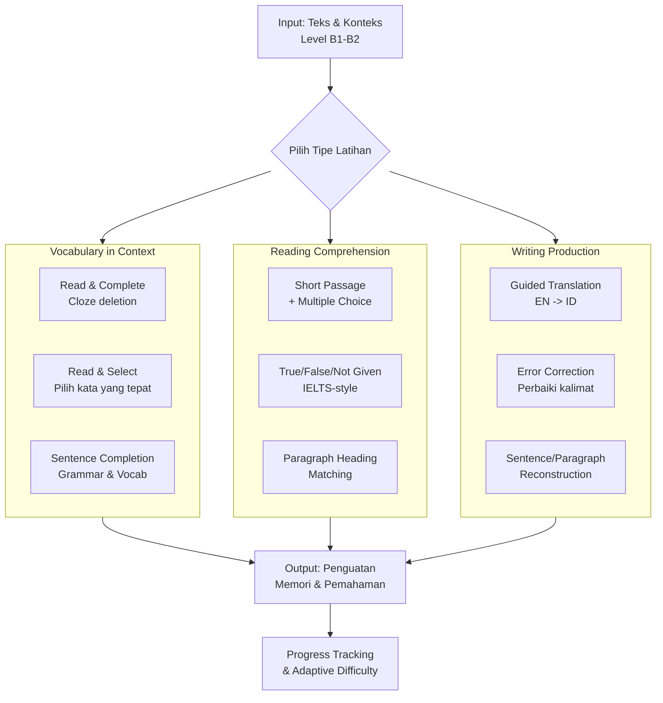

Berdasarkan kebutuhan spesifik Anda untuk **persiapan IELTS/TOEIC level B1-B2** dengan fokus pada **vocab, reading, dan writing**, berikut adalah rekomendasi tipe-tipe quiz yang dirancang khusus untuk dewasa, mengadopsi konsep efektif dari Duolingo English Test (DET) tanpa unsur audio/video atau flashcard yang biasa.

### 🎯 Prinsip Desain untuk Quiz Level B1-B2
Sebelum masuk ke tipe quiz, penting memahami prinsip yang membedakannya dari game bahasa umum:
*   **Kontekstual & Akademis**: Kosakata dan tata bahasa harus berasal dari konteks akademik (IELTS) atau bisnis (TOEIC), bukan percakapan sehari-hari 【turn0search2】.
*   **Produksi, Bukan Hanya Pengenalan**: Tugas harus memaksa pengguna **memproduksi** bahasa (menulis, menyusun), bukan hanya memilih dari opsi. Ini sesuai dengan keterampilan yang dibutuhkan dalam writing test 【turn0search4】.
*   **Format Det Yang Adaptif**: Sistem yang menyesuaikan kesulitan soal berdasarkan performa pengguna real-time adalah kunci pengalaman yang menantang dan efisien 【turn0search2】.

### 📝 Rekomendasi Tipe-Tipe Quiz & Mekaniknya
Berikut adalah 8 tipe quiz inti yang direkomendasikan, lengkap dengan penjelasan, contoh, dan tujuannya:

#### 1. **Read & Complete (Cloze Deletion)**
*   **Tujuan**: Melatih **kosakata aktif** dan **pemahaman bacaan** dalam konteks. Ini adalah versi yang jauh lebih canggih dari flashcard.
*   **Mekanik Game**: Pengguna melihat sebuah kalimat atau paragraf pendek (2-3 kalimat) dengan **satu atau dua kata kunci yang hilang**. Mereka harus mengisi kekosongan tersebut dengan mengetik kata yang tepat, berdasarkan konteks dan pengetahuan tata bahasa mereka.
*   **Contoh Soal (TOEIC Context)**:
    > "The manager asked for a detailed report on the project's __________ before making any final decisions."
    > *(Jawaban: progress / status / performance)*
*   **Kenapa Bagus**: Tugas ini menuntut pemahaman mendalam terhadap kalimat dan kemampuan mengingat kata yang tepat, bukan sekadar mengenali. Sistem dapat memberikan feedback instan dan penjelasan.
*   **Referensi Konsep**: Ini adalah inti dari tipe "Read and Complete" yang dikenal dalam persiapan DET 【turn0search4】.

#### 2. **Read & Select (Pilih Kata yang Tepat)**
*   **Tujuan**: Melatih **nuansa kata (collocations)** dan **pemahaman leksikal**. Mengatasi kesulitan umum learner B1-B2: tahu banyak kata tapi bingung mana yang tepat dalam konteks.
*   **Mekanik Game**: Pengguna melihat sebuah kalimat dengan satu kata yang digarisbawahi. Mereka harus **memilih kata yang paling tepat** untuk menggantikan kata tersebut dari 3-4 pilihan yang tersedia. Pilihan-pilihan tersebut adalah kata yang mirip makna tapi tidak kolokasi dengan baik.
*   **Contoh Soal (IELTS Context)**:
    > "The research team conducted a thorough **investigation** into the causes of the disease."
    > Pilihan: (a) inquiry (b) research (c) study (d) examination
    > *(Jawaban paling tepat: (c) study, karena "conduct a study" adalah kolokasi yang umum dalam konteks akademik)*
*   **Kenapa Bagus**: Membangun kesadaran akan pola bahasa yang natural, krusial untuk writing dan reading test.

#### 3. **Complete the Sentence (Grammar & Vocabulary Integration)**
*   **Tujuan**: Melatih **struktur kalimat** yang kompleks (khas IELTS/TOEIC) dengan menggabungkan pengetahuan vocab dan grammar.
*   **Mekanik Game**: Pengguna diberikan bagian awal dan akhir kalimat, serta beberapa kata/frasa penghubung atau kosakata. Mereka harus **menyusun dan mengetik** bagian tengah kalimat yang tepat untuk menghubungkannya secara logis dan gramatikal.
*   **Contoh Soal**:
    > "Despite __________, the team managed to complete the project on time."
    > Kosakata yang diberikan: (limited resources, they faced numerous challenges, the tight deadline)
    > *(Contoh Jawaban: "limited resources and the tight deadline")*
*   **Kenapa Bagus**: Ini adalah latihan produksi semi-terbuka yang sangat baik untuk menyiapkan tugas menulis yang lebih panjang.

#### 4. **Reading Comprehension: Short Passage + Questions**
*   **Tujuan**: Melatih **kemampuan membaca** untuk detail, main idea, dan inferensi, seperti dalam IELTS/TOEIC.
*   **Mekanik Game**:
    1.  **Baca Teks Pendek**: Teks sepanjang 80-120 kata tentang topik akademik atau bisnis.
    2.  **Jawab Pertanyaan**: 3-4 pertanyaan dengan tipe yang bervariasi:
        *   **Multiple Choice**: Untuk memahami detail atau makna kata dalam teks.
        *   **True/False/Not Given**: Khas IELTS, melatih kemampuan membedakan fakta, inferensi, dan informasi yang tidak disebutkan.
        *   **Short Answer**: Menjawab pertanyaan dengan kalimat singkat berdasarkan teks.
*   **Kenapa Bagus**: Membangun stamina membaca dan kemampuan memindai teks secara efisien, keterampilan inti dalam reading test.

#### 5. **Guided Translation (English to Indonesian)**
*   **Tujuan**: Melatih **pemahaman mendalam** terhadap struktur kalimat bahasa Inggris yang kompleks dan **kemampuan menulis** dalam bahasa Inggris yang akurat.
*   **Mekanik Game**: Pengguna melihat kalimat atau paragraf pendek dalam bahasa Inggris. Mereka harus **mengetik terjemahan** ke dalam bahasa Inggris yang benar, dengan petunjuk kosakata atau frasa yang diberikan (jika perlu).
*   **Contoh Soal**:
    > Terjemahkan kalimat berikut ke dalam Bahasa Inggris yang baik:
    > "Meskipun penelitian ini menjanjikan, masih diperlukan bukti lebih lanjut sebelum kesimpulan dapat ditarik."
    > *(Petunjuk: "promising" / "further evidence" / "draw conclusions")*
*   **Kenapa Bagus**: Memaksa pengguna untuk berpikir dalam struktur bahasa Inggris yang benar, bukan hanya menerjemahkan kata per kata. Sangat efektif untuk memperbaiki grammar dan kosakata aktif.

#### 6. **Error Correction**
*   **Tujuan**: Melatih **ketelitian** terhadap kesalahan grammar, spelling, dan word choice yang umum, yang penting untuk writing test.
*   **Mekanik Game**: Pengguna melihat sebuah kalimat atau paragraf pendek yang mengandung 2-3 kesalahan. Mereka harus **mengidentifikasi dan memperbaiki** kesalahan tersebut.
*   **Contoh Soal**:
    > "The number of students who studies abroad are increasing every year."
    > *(Kesalahan: "studies" seharusnya "study", "are" seharusnya "is" karena subjeknya "The number")*
    > **Tugas**: Perbaiki kalimat di atas.
*   **Kenapa Bagus**: Membangun kesadaran grammar yang tinggi dan kebiasaan proofreading.

#### 7. **Sentence/Paragraph Reconstruction**
*   **Tujuan**: Melatih **pemahaman kohesi dan koherensi** teks, serta struktur paragraf yang baik, krusial untuk writing Task 2 IELTS.
*   **Mekanik Game**: Pengguna diberikan 4-5 kalimat yang diacak dari sebuah paragraf yang koheren. Mereka harus **menyusunnya** menjadi paragraf yang logis dan terstruktur dengan baik.
*   **Contoh Soal**:
    > Kalimat-kalimat acak:
    > (1) Furthermore, it helps to reduce stress and improve mental health.
    > (2) First and foremost, regular exercise strengthens the cardiovascular system.
    > (3) In conclusion, the benefits of exercise are multifaceted and undeniable.
    > (4) Exercise is essential for maintaining a healthy lifestyle.
    > (5) It also plays a crucial role in weight management.
    > **Tugas**: Susun kalimat-kalimat di atas menjadi paragraf yang benar.
*   **Kenapa Bagus**: Mengajarkan bagaimana menghubungkan ide dengan transition words yang tepat.

#### 8. **Write About the Text (Short Response)**
*   **Tujuan**: Melatih **kemampuan menulis** akademik sederhana berdasarkan sumber bacaan, seperti ringkasan atau respons pendek.
*   **Mekanik Game**: Pengguna membaca sebuah teks pendek (2-3 paragraf) lalu diminta untuk **menulis ringkasan** (60-80 kata) atau **memberikan opini singkat** tentang topik yang dibahas, dengan menggunakan kosakata dan struktur dari teks tersebut.
*   **Kenapa Bagus**: Ini adalah jembatan antara reading dan writing, memaksa pengguna untuk memahami dan memproduksi teks secara akademis. Sistem dapat memberikan feedback otomatis tentang panjang, kosakata yang digunakan, dan kejelasan.

### 📊 Perbandingan Tipe Quiz & Fokusnya
| Tipe Quiz | Keterampilan Utama yang Dilatih | Tingkat Kesulitan (B1-B2) | Format Jawaban |
| :--- | :--- | :--- | :--- |
| **Read & Complete** | Vocabulary in Context, Grammar |  | Mengetik kata |
| **Read & Select** | Vocabulary Nuance, Collocation |  | Multiple Choice |
| **Complete the Sentence** | Grammar, Vocabulary, Coherence |  | Menyusun & mengetik |
| **Reading Comprehension** | Reading for Detail, Inference |  | Multiple Choice, T/F/NG, Short Answer |
| **Guided Translation** | Grammar, Vocabulary Production |  | Mengetik terjemahan |
| **Error Correction** | Grammar Accuracy, Proofreading |  | Identifikasi & perbaikan |
| **Paragraph Reconstruction** | Coherence, Cohesion, Structure |  | Drag & drop / urutan |
| **Write About the Text** | Writing Production, Summarizing |  | Menulis esai pendek |

### 💡 Rekomendasi Implementasi & Fitur Pendukung
1.  **Adaptive Engine**: Implementasi sistem yang menyesuaikan tingkat kesulitan soal berdasarkan performa pengguna. Jika pengguna benar beruntun, level soal naik; jika salah, turun. Ini inti dari pengalaman DET 【turn0search2】.
2.  **AI-Powered Feedback**: Untuk tipe quiz yang menulis (Guided Translation, Write About the Text), integrasikan AI yang dapat memberikan feedback otomatis tentang grammar, kosakata, dan kejelasan, berdasarkan rubrik penilaian IELTS/TOEIC 【turn0search2】.
3.  **Progress Dashboard**: Tampilkan progress yang spesifik, seperti "Grammar: 75% mastery", "Academic Vocabulary: 120 words learned", "Reading Speed: 150 wpm". Ini memotivasi dan memberikan arahan belajar.
4.  **Content Bank yang Terkurasi**: Bangun bank soal yang luas dan terbagi berdasarkan topik (Environment, Technology, Business, Education) dan tipe soal. Setiap soal harus memiliki penjelasan yang mendalam.
5.  **Gamifikasi yang Dewasa**: Alih-alih lencana dan avatar, gunakan **progress map** (seperti peta perjalanan menuju skor target), **leaderboard mingguan**, dan **streak counter** yang fokus pada konsistensi belajar.

Dengan menggabungkan tipe-tipe quiz di atas dan fitur pendukung yang tepat, Anda dapat membangun platform persiapan IELTS/TOEIC yang tidak hanya efektif tetapi juga engaging dan menantang bagi learner dewasa di level B1-B2.